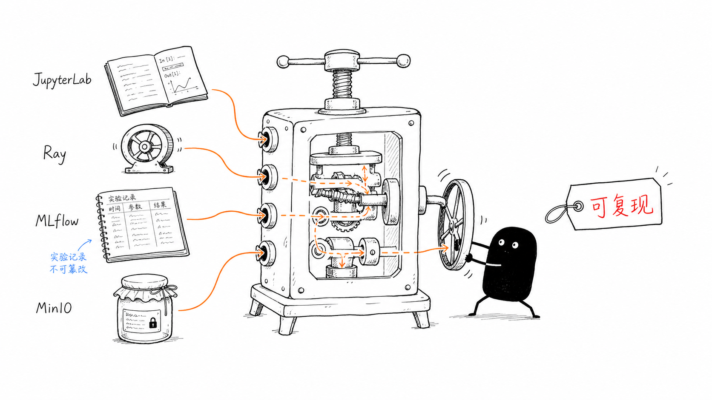
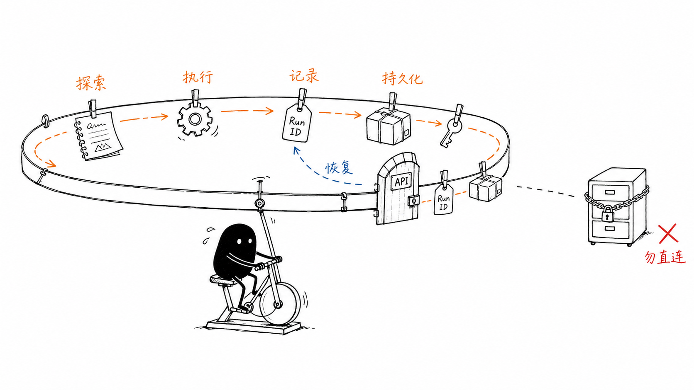
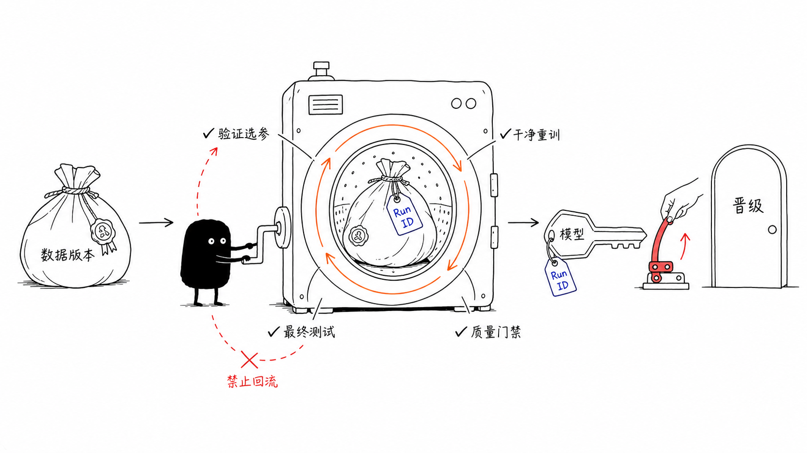
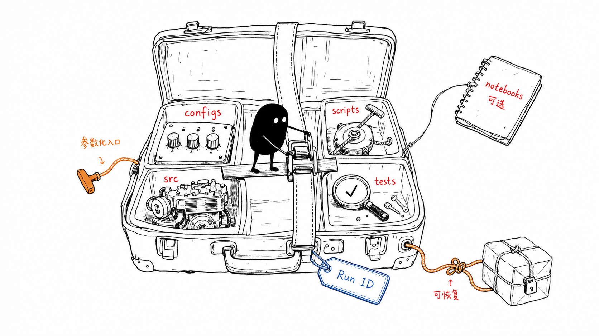

# Galatea：让模型从数据中苏醒

> **一句话定位：** 用 JupyterLab 开发，用 Ray 执行，用训练框架计算，用 MLflow 记录和治理，
> 用 MinIO 长期保存，把一次实验变成可重复、可审计、可恢复的训练资产。

本仓库面向多项目、多模型和多框架，不是某一个模型的工程模板。当前的 Cats vs Dogs 只是
TensorFlow/Keras 示例工作负载；平台同样可承载 PyTorch、scikit-learn、XGBoost/LightGBM、
Ray Train 及其他能够接入 MLflow 的训练项目，覆盖分类、回归、检测、分割、排序、推荐、
时序预测和大模型微调等任务。

README 分为两层：先沿着四张图理解平台如何运转，再进入可检索的部署与运维手册。

Codex 是仓库唯一的 Agent Runtime。Web Agent 由
[`agents/codex-app-server`](agents/codex-app-server/README.md) 托管原生 `codex app-server`，
复用其 Agent Loop、Thread、Turn、Skill、沙箱与审批。通用 Host 提供网页工作台、协议转发、
会话恢复和可配置的 Tool Provider；业务能力通过外部 MCP 或独立 Provider 接入。
当前 Host 不内置 Galatea 服务或训练流程，真实训练联动和业务阶段可视化仍需单独接入与验收。

仓库训练通过 [`.codex/skills/`](.codex/skills/) 和项目固定治理入口执行；
[`galatea-governance`](packages/galatea-governance/README.md) 校验项目 YAML、Release 和执行证据，
独立 [`galatea-mcp`](services/galatea-mcp/README.md) 提供 Campaign、预算与平台工具约束。
Codex 审批不能替代训练授权，业务组件也不实现第二套 Agent Loop、会话或原生权限系统。
完整职责、接入路径及迁移边界见 [`doc/agent-galatea.md`](doc/agent-galatea.md)。

## 图解导览

### 1. 平台不是单一模型，而是一台训练装置

单个 Notebook 可以完成一次实验，却很难独自回答数据来自哪里、任务由谁执行、指标记录在哪、
模型如何恢复。平台的价值，是把原本分散的开发、计算、治理和存储连接成同一条可靠链路。



#### 读图：四种能力怎样合成一次可复现训练

- **JupyterLab 是工作台**：承接数据探索、Notebook 实验、配置编写和小规模验证。
- **Ray 是动力轮**：把参数化任务调度到 CPU/GPU，并负责分布式执行和失败重试。
- **MLflow 是实验账本**：让参数、指标、数据血缘、Artifact 和模型版本归属于明确的 Run。
- **MinIO 是耐久仓库**：保存数据版本、Checkpoint、模型、预测结果和可视化 Artifact。
- **小黑转动的是连接关系**：任何单一组件都不等于平台，只有链路完整才能得到“可复现”。

#### 平台统一的六件事

- **统一开发入口**：通过 JupyterLab 完成数据探索、Notebook 实验和小规模验证。
- **统一执行入口**：项目固定治理入口提交 Ray Job，任务内部使用 Ray Core 或 Ray Train 执行 CPU/GPU 计算。
- **统一实验记录**：通过 MLflow Tracking API 保存参数、指标、标签、数据血缘和运行状态。
- **统一模型治理**：通过 MLflow Logged Models、Model Registry、质量门禁和别名管理候选模型。
- **统一对象存储**：通过 MinIO 保存数据版本、Checkpoint、模型、预测结果和可视化 Artifact。
- **统一运维方式**：通过 systemd、健康检查、受控环境文件和备份流程管理平台服务。

### 2. 组件各司其职，实验记录和 Artifact 只走 API

平台不是把多个服务并排安装，而是给每个组件划清责任边界。训练客户端只通过 MLflow
Tracking/Artifact API 访问平台，不读取 MLflow 后端数据库，也不直接持有 Artifact Bucket
的长期 MinIO 密钥。



#### 读图：为什么这个闭环可以恢复

- **橙色路径持续向前**：探索、执行、记录、持久化和恢复属于同一个训练上下文。
- **Run ID 与 Checkpoint 一起流转**：任务失败后能找到原始证据和恢复位置，而不是依赖 Kernel 记忆。
- **API 是唯一入口**：实验元数据和 Artifact 使用稳定接口，MLflow 可以迁移而不改变训练项目的访问方式。
- **后端抽屉被锁住**：`mlflow.db` 和服务端对象存储实现属于平台内部，不能成为客户端集成接口。
- **小黑必须持续踩动**：可恢复性来自每次训练都遵循规则，而不是事后补写一份实验记录。

#### 组件职责边界

| 组件 | 负责 | 不负责 |
| --- | --- | --- |
| JupyterLab | 数据探索、交互开发、Notebook、小样本验证 | 长时间正式训练的可靠调度 |
| Ray Jobs / Core / Train | 任务提交、资源调度、分布式执行、失败重试 | 保存实验历史和模型版本 |
| TensorFlow / PyTorch / 其他框架 | 模型、Loss、Optimizer、训练与评测逻辑 | 集群调度和平台治理 |
| MLflow Tracking | Run、参数、指标、Tag、Dataset Input、Artifact 元数据 | 分配 GPU 或保存原始业务数据 |
| MLflow Model Registry | 模型版本、说明、别名和晋级关系 | 训练任务执行 |
| MinIO | 训练数据、Checkpoint、模型和 Artifact 的 S3 兼容持久化 | 训练逻辑和实验选择 |
| Codex | Agent Loop、Thread/Turn、Skill、原生工具、沙箱与审批 | 项目训练授权和质量门禁 |
| 通用 Host | 托管原生进程、网页交互、可选 Provider 与会话恢复 | 模型决策和训练业务状态机 |
| Galatea 治理组件 | 固定入口、不可变 Release、授权预算和执行证据校验 | Agent Loop、模型客户端和原生沙箱 |
| systemd | 平台服务与 Ray Head 的进程生命周期 | Ray 训练业务逻辑 |

#### 参考架构

```text
算法工程师 / 平台工程师
          |
          v
JupyterLab：探索、开发、配置、Smoke Test
          |
          v
数据校验与版本化 <----------------------- MinIO training-data
          |
          v
Ray Job / Ray Train：CPU、GPU、分布式执行
          |
          +--> TensorFlow / PyTorch / sklearn / Boosting
          |
          +--> 参数、指标、Dataset Input、日志 ----> MLflow Tracking API
          |
          +--> Checkpoint、模型、报告 ------------> MLflow Artifact API
                                                        |
                                                        v
                                              MinIO mlflow-artifacts
                                                        |
                                                        v
                              评测与质量门禁 -> Model Registry
                                                        |
                                               candidate / champion
```

### 3. 一次训练必须带着身份走到晋级

“模型指标不错”不足以证明结果可信。数据版本、切分、代码、配置、环境和 Run ID 必须从训练
开始就绑定在一起；验证集负责选择，测试集只做最终评测，生产别名只能在质量门禁和人工审核后更新。



#### 读图：训练鼓里的四条治理规则

- **数据袋有封签**：原始数据、Manifest、内容摘要和切分摘要共同确定不可变的数据身份。
- **Run ID 不离身**：参数、指标、代码、环境、Checkpoint 和报告始终能够回到同一次运行。
- **最终测试禁止回流**：Trial 只使用训练集和验证集，不能反复看测试集再调整超参数。
- **Champion 从干净状态重训**：选定配置后重新训练，再执行一次最终测试集评测。
- **晋级前还有一只手**：质量门禁通过不等于自动上线，模型别名变更需要明确的人工审核。

#### 完整训练生命周期

1. **数据进入**：原始数据以不可变版本写入 MinIO，并生成 Manifest、内容摘要和切分摘要。
2. **实验开发**：在 JupyterLab 中完成数据、配置与前向检查；参数更新、拟合或真实 Checkpoint 输出均按 Training Run 管理。
3. **任务提交**：声明 Ray 后端的项目将所有 Training Run（含 smoke、baseline、Trial 和 Champion）经固定治理入口提交，并绑定不可变 Release、显式集群与授权证据。
4. **实验追踪**：每次训练创建独立 MLflow Run，记录代码、数据、配置、环境、指标和 Artifact。
5. **验证集选参**：Trial 只使用训练集和验证集；不得用测试集反复选择超参数。
6. **Champion 重训**：选定配置后从干净状态重训，再执行一次最终测试集评测。
7. **质量门禁**：检查主指标、分组指标、Artifact 可恢复性、数据血缘和代码可复现性。
8. **模型晋级**：人工审核后注册模型并更新 `candidate`、`champion` 等别名。

一次可审计训练至少应回答：使用哪个数据和切分、哪份配置和代码、由哪个 Ray Job 执行、
对应哪个 MLflow Run、指标为何满足门禁，以及模型和 Checkpoint 从哪里恢复。

### 4. 新项目是一只工程箱，不是一份长期运行的 Notebook

新训练项目统一放在 `train-model/<project-name>/` 下。一个项目可以包含多个模型、算法和参数
变体，但正式训练必须有可以脱离 Notebook 执行的参数化入口，并能从 Artifact 服务恢复。



#### 读图：项目箱里每个部件解决什么问题

- **`configs/` 是旋钮**：开发、调优和正式训练使用显式配置，而不是散落在 Notebook 全局变量中。
- **`src/` 是发动机**：数据、模型、训练、评测和注册逻辑可以被脚本、Notebook 和测试复用。
- **`scripts/` 是启动绳**：`validate`、`train`、`evaluate`、`promote` 提供可调度、可恢复的正式入口。
- **`tests/` 是放大镜**：验证数据切分、指标语义、选择逻辑和最小训练路径没有悄悄改变。
- **`notebooks/` 拴在箱外**：它适合探索、展示和 Smoke Test，但不承载不可恢复的长期状态。
- **Run ID 和 Artifact 是行李牌与安全绳**：失败任务知道自己是谁，也知道从哪里继续。

#### 推荐项目结构

```text
train-model/<project-name>/
├── README.md                 # 数据、目标指标、运行方式和门禁
├── notebooks/               # 探索与 Smoke Test
├── configs/                 # 开发、调优和正式训练配置
├── src/                     # 数据、模型、训练、评测和注册逻辑
├── scripts/                 # validate/train/evaluate/promote 入口
└── tests/                   # 数据、模型、选择逻辑和 Smoke Test
```

现有项目可以保留较轻量的平铺结构，但必须满足以下平台契约：

- 配置与训练代码分离，正式入口可以脱离 Notebook 执行。
- 数据来源、内容摘要、切分摘要和预处理版本进入 MLflow。
- 每个 Run 记录 `project`、模型变体、代码版本、Seed、资源和完整超参数。
- 指标区分训练、验证和最终测试语义，并明确主目标的优化方向。
- Checkpoint、模型、预测和报告通过 MLflow Artifact API 持久化。
- Ray 重试不会重复覆盖其他 Run，分布式训练只由一个权威进程写 MLflow。
- 探索任务不自动修改生产模型别名。
- 凭据、数据集、Checkpoint、生成模型和 `.ipynb_checkpoints/` 不进入 Git。

正式项目应优先采用参数化脚本提交 Ray Job。Notebook 负责调用和展示，不承载不可恢复的
长期训练状态。

---

## 运维与参考手册

以下章节对应仓库记录的当前开发机器；执行前按
[平台运行记忆](doc/platform-runtime-memory.md)核对目标集群、资源和凭据 profile。
旧部署手册中的路径和端口不作为当前默认值。

### 当前部署形态

当前机器基线记录于 2026-10-14，详细配置见
[当前机器部署](doc/local-services-18100.md)：

- 平台 Conda 环境：`/data/miniconda3/envs/attend-ray-py312`；工作负载使用各自环境
- 工作目录：`/data/ai/chenzhangyue/galatea-model/galatea`
- MLflow、MinIO、开发 Ray Head：由 systemd 管理；JupyterLab 按需独立配置
- Ray：显式选择开发或生产 profile；开发 Head 使用 `ray-head.service`
- MLflow Backend Store：本机 `platform-data/mlflow/mlflow.db`
- MLflow Artifact Store：由 Tracking Server 代理写入 MinIO `s3://mlflow-artifacts`
- 运行数据：仓库 `platform-data/` 软链接到上级运行数据目录，不进入 Git

Backend Store 是服务端实现细节。Notebook、Ray Worker、分析脚本和其他客户端必须使用
MLflow API，不应读取 `mlflow.db`。当前 MinIO 是单机单盘部署，不提供主机故障容错；
数据库、对象数据和密钥需要成组备份到其他主机或独立存储。

### 快速开始

#### 1. 激活环境

```bash
source /data/miniconda3/etc/profile.d/conda.sh
conda activate attend-ray-py312
cd /data/ai/chenzhangyue/galatea-model/galatea
```

#### 2. 检查平台服务

```bash
systemctl is-active minio.service
systemctl is-active mlflow.service
systemctl is-active ray-head.service

curl -fsS http://127.0.0.1:18103/health
curl -fsS http://127.0.0.1:18101/minio/health/live
ray status --address=10.26.0.140:18104
```

这些命令针对已登记的开发 profile。其他集群先按 [Ray 部署指南](doc/ray-start.md) 核对
GCS、Jobs API、节点与资源，不使用自动发现或全局 `ray stop` 管理共享机器。

#### 3. 配置 MLflow 客户端

```bash
export MLFLOW_TRACKING_URI=http://127.0.0.1:18103
export MLFLOW_EXPERIMENT_NAME="project-experiment-name"
```

远程 MLflow 使用对应的 HTTPS Tracking URI 和受控认证配置，不复制服务端数据库或 MinIO
长期密钥到训练项目。

#### 4. 本地启动 JupyterLab（仅在未使用 systemd 时）

```bash
jupyter lab --no-browser --allow-root --ServerApp.root_dir="$PWD"
```

### 服务与端口

| 服务 | 当前开发配置端口 | 当前管理方式 | 说明 |
| --- | ---: | --- | --- |
| JupyterLab | 8888（示例） | 按需配置 | 交互开发入口，旧代理地址需按主机调整 |
| MLflow Tracking | 18103 | systemd | Run、模型和 Artifact API |
| MinIO API | 18101 | systemd | S3 兼容对象接口 |
| MinIO Console | 18102 | systemd | 对象存储管理界面 |
| Ray Head / GCS | 18104 | ray-head.service | 与 Jobs HTTP 地址分离 |
| Ray Dashboard / Jobs API | 8265 | ray-head.service | Ray 状态、任务和资源观察 |
| Codex Web Host | 18880（模板） | 独立启动或 unit | 通用工作台；部署需独立接纳 |

`systemd/` 中的用户、路径、监听地址、代理前缀和允许域名都是当前主机配置。安装前先验证：

```bash
systemd-analyze verify systemd/*.service
```

监听 `0.0.0.0` 的服务必须由防火墙、认证代理或受控内网保护，不能直接暴露到公网。

### MLflow 实验分析与通用调优

工程内置通用 Skill：

```text
.codex/skills/mlflow-optimize-models/
```

它通过本地或远程 MLflow Tracking API 分析可比 Run、验证目标、参数覆盖、学习曲线、
泛化差距、质量门禁和 Artifact 状态，再把证据映射为参数或代码优化建议。它不预设模型
类型、训练框架或 `accuracy` 指标；目标可以是需要最大化的 AUC、F1、mAP，也可以是需要
最小化的 Loss、RMSE、MAE 等项目指标。它不会读取 `mlflow.db`，也不会默认使用测试指标选参。

直接运行分析脚本：

```bash
export MLFLOW_OBJECTIVE_METRIC="project_validation_metric"

python .codex/skills/mlflow-optimize-models/scripts/analyze_experiment.py \
  --tracking-uri "$MLFLOW_TRACKING_URI" \
  --experiment "$MLFLOW_EXPERIMENT_NAME" \
  --objective-metric "$MLFLOW_OBJECTIVE_METRIC" \
  --objective-mode max \
  --repo-root "$PWD"
```

按指标语义选择 `--objective-mode max` 或 `--objective-mode min`。不同任务、数据版本、切分
策略或指标定义的 Run 不应直接排名；先筛选可比 Run，再判断当前最佳结果和下一轮搜索空间。

也可以在 Codex 中使用 `$mlflow-optimize-models`，针对任意 Experiment 生成分析、调优和
代码修改方案。分析或代码优化请求本身不会自动启动 CPU/GPU 训练。

### 示例工作负载

#### Cats vs Dogs 图像分类

[`train-model/cats-and-dogs/`](train-model/cats-and-dogs/) 是当前端到端示例，展示：

- TensorFlow/Keras 基础 CNN、数据增强和迁移学习调优空间；
- 内容寻址的数据版本与确定性训练/验证/测试切分；
- MLflow Run、Dataset Input、模型、Checkpoint、预测、图表和环境记录；
- MinIO Artifact 回读验证；
- 验证集驱动的自动调优与 Champion 重训。

示例用于验证平台能力，不定义平台支持的模型类型或框架边界。

### 仓库结构

```text
galatea/
├── .codex/skills/                 # 工程级 Codex Skills
├── agents/codex-app-server/       # 原生 Codex app-server Host 与 Console
├── services/galatea-mcp/          # Python 平台治理与 MCP 接口
├── packages/galatea-governance/   # 项目固定入口的 Release、证据和提交校验
├── packages/galatea-training-skills/ # 可独立发布的训练 Skill 包
├── train-model/                   # 多个训练项目和模型工作负载
│   ├── cats-and-dogs/             # TensorFlow/Keras 示例
│   └── ray-cats-and-dogs/         # Ray Train/PyTorch 治理示例
├── tests/                         # 仓库级和跨项目契约测试
├── doc/                           # 部署、运维和端到端实施手册
├── systemd/                       # JupyterLab、MLflow、MinIO、Ray Head Unit
├── platform-data/                 # 数据库、对象和运行状态（Git 忽略）
├── AGENTS.md                      # 仓库开发约定
└── README.md
```

### 验证

运行仓库级及两个示例项目测试：

```bash
/data/miniconda3/envs/attend-ray-py312/bin/python -m unittest discover \
  -s tests -p 'test_*.py'

/data/miniconda3/envs/attend-ray-py312/bin/python -m unittest discover \
  -s train-model/cats-and-dogs/tests -p 'test_*.py'

/data/miniconda3/envs/attend-ray-py312/bin/python -m unittest discover \
  -s train-model/ray-cats-and-dogs/tests -p 'test_*.py'
```

这些测试应使用前向检查或模拟后端。真实训练 smoke 仍通过项目固定治理入口执行，
短时长或小数据集不构成本地训练例外。Notebook 的只读验证输出写入临时目录，不覆盖源文件。
Host 自身的协议、前端与恢复验证见 [Host 测试验收](agents/codex-app-server/docs/09-test-acceptance.md)。

### 文档

- [当前机器服务部署](doc/local-services-18100.md)
- [多集群与授权边界运行记忆](doc/platform-runtime-memory.md)
- [JupyterLab 安装与运维](doc/jupyter-start.md)
- [MLflow Tracking Server 安装与运维](doc/mlflow-start.md)
- [MinIO 安装与运维](doc/minio-start.md)
- [Ray 安装、启动与任务提交](doc/ray-start.md)
- [code-server 代理配置](doc/code-server-proxy.md)
- [数据到训练到模型的端到端实施手册](doc/train-guide/data-to-training-to-model-imp-guide.md)
- [Ray 训练接入与运行规范](doc/train-guide/ray-training-guide.md)
- [MLflow 训练指标手册](doc/train-guide/mlflow-training-integration-spec.md)
- [Codex 与 Galatea 架构](doc/agent-galatea.md)
- [Codex app-server 安装与运行](agents/codex-app-server/README.md)
- [Codex app-server 配置与部署](agents/codex-app-server/docs/06-config-deployment.md)
- [仓库开发规范](AGENTS.md)

### 安全与持久化

- 不提交 Token、对象存储密钥、环境文件或包含凭据的 Notebook 输出。
- `platform-data/` 只保存运行状态，不作为源码分发；MLflow 元数据与 MinIO 对象必须一致备份。
- 训练客户端只获取完成任务所需的最小权限，MinIO 长期密钥保留在受保护的服务端环境文件。
- 未认证服务优先绑定回环地址；必须监听所有网卡时，使用防火墙和认证代理。
- 数据版本不可覆盖，模型必须能够通过 MLflow Run ID 追溯到代码、配置和数据。
- 当前单节点部署不等于高可用；生产化前需要补充异机备份、恢复演练、监控和容量告警。
