# Codex Agent Host

基于原生 `codex app-server` 的通用 Agent 与网页工作台。Agent 自主选择 Skill、工具和下一步行动；Host 负责进程、会话、审批、调用记录和恢复，不定义训练阶段或业务节点。

当前完成第一阶段：可独立运行，通过配置连接 Skill、自定义 Tool 和外部 MCP。第二阶段再接入 Galatea 等业务服务，并增加阶段、资源和产物可视化。

仓库整体职责见 [Codex 与 Galatea 架构](../../doc/agent-galatea.md)。本组件不内置 Galatea Adapter；
项目 YAML 固定入口与 MCP Campaign 服务分别维护业务授权和执行证据。旧训练 Skill 包的
`wait_external` 不会触发 Host 自动轮询或恢复 Campaign，使用该约定需另行实现并验收外部编排。

快速导航：[产品界面导览](#product-ui) · [启动](#启动) · [接入能力](#接入能力) ·
[项目与权限交互细节](#项目与权限交互) · [验证](#验证) · [技术文档目录](docs/README.md)

<a id="product-ui"></a>

## 产品界面导览

Codex Agent Host 将原生 Codex 的工作过程组织成一个浏览器工作台，界面左上角标识为
**open-codex**。用户围绕项目发起聊天，在同一个页面阅读代码、查看执行过程、回答审批问题、
检查文件差异，并通过 Skills、MCP、Apps 和插件接入外部能力。
它适合代码开发、文档整理、项目分析和工具协作；训练业务需要另行接入 Galatea 的治理与执行服务。

以下截图采集于 **2026-10-18**，使用当前 `frontend/` 源码构建，并在隔离的演示 Host 中实际渲染。
项目名称、聊天内容、模型、文件差异和终端输出均为演示数据，没有调用真实模型或执行训练。
截图展示现有界面，不代表截图中的演示任务或外部服务已通过生产验收。
图片保存在 [docs/images/ui-tour/](docs/images/ui-tour/)，点击可查看原图。

### 1. 工作台全貌：项目、聊天与操作入口

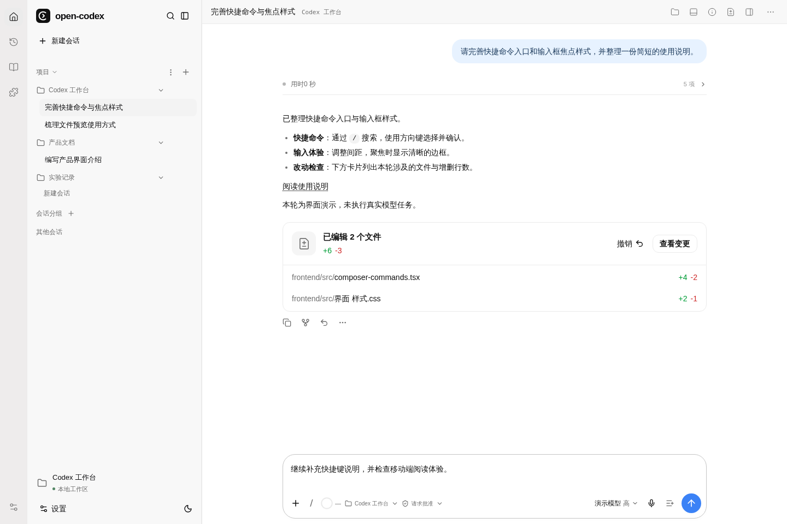

*图 1：一轮任务完成后的工作台。回复下方直接展示本轮文件变化，输入框仍可继续补充要求。*

| 界面区域 | 主要内容 | 典型用途 |
| --- | --- | --- |
| 最左侧导航栏 | 工作台、历史及扩展相关入口 | 在日常聊天、历史记录和扩展管理之间切换 |
| 左侧项目与会话栏 | 新建会话、搜索、项目、项目分组、会话分组 | 按代码仓库或工作主题组织聊天，继续之前的任务 |
| 顶部会话栏 | 会话标题、所属项目、文件、终端、摘要、更改、任务面板及更多操作 | 快速打开与当前聊天相关的内容 |
| 中央聊天区 | 用户消息、过程记录、最终回复、审批与文件变更卡片 | 理解 Agent 做了什么，并检查结果 |
| 底部输入区 | 文本、附件、引用、项目、权限、模型、推理强度、语音及队列 | 组织下一步任务并控制执行方式 |
| 右侧任务面板 | 文件与预览、摘要、更改、后台终端、审批记录、子 Agent | 保留对话和草稿，同时查看任务细节 |
| 底部终端 | 沙箱命令、主机进程、终端标签与输出 | 在当前工作目录检查命令结果或继续交互 |

右侧面板和底部终端按需打开。左侧会话栏、右侧任务面板可以调整宽度，
文件阅读和面板切换不会重建聊天输入框，适合边读文件边补充任务。

### 2. 项目与历史：按工作目录组织持续协作

从侧栏项目标题旁的 **「＋」** 添加服务器上的已有目录，也可以创建文件夹后作为项目使用。
项目菜单支持重命名、编辑目录、移动分组和排序；项目、分组与会话也可以拖动整理。

- **一个项目可以有多个工作目录**：编辑项目时增加、移除或排序；第一个目录作为新聊天的默认目录。
- **同一文件夹可以建立多个项目**：项目有独立 ID 和名称，可按用途分别组织会话。
- **聊天可以移动到其他项目**：侧栏拖动或输入框下方切换项目，会更新后续任务的工作目录；
  正在回复时需要先等待本轮结束。
- **搜索和历史各有入口**：放大镜支持搜索聊天及正文命中位置，也提供文件搜索入口；
  历史页可查看全部、已归档聊天并恢复会话。
- **会话可继续、分叉和归档**：需要保留上下文探索另一条思路时，可从已有轮次建立分支；
  整理完成的工作时可归档，之后再恢复。

项目与会话组织保存在同一 Host / Codex Home 中；主题、折叠状态、栏宽等展示偏好保存在浏览器。
切换到另一台 Host 不会自动同步项目和历史。项目目录指服务器文件系统，文件上传则是另一条输入入口。

### 3. 输入框：任务、引用、权限与连续输入

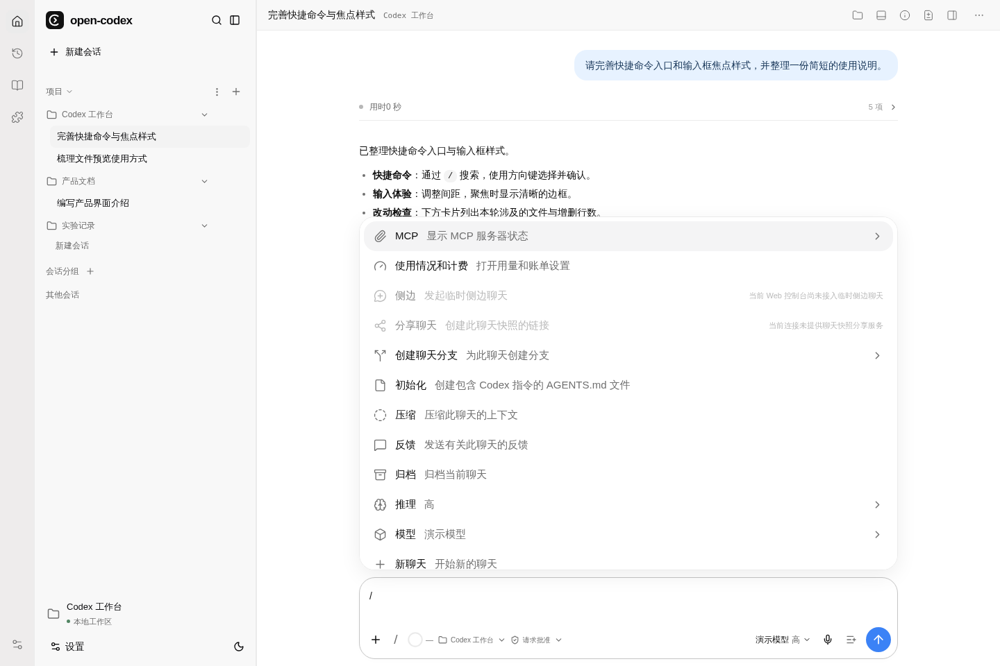

*图 2：输入 `/` 打开快捷命令列表，常用动作可以直接在聊天中完成。*

普通任务直接输入文字并发送。输入框 **「＋」** 可以上传文件，选择目标或计划模式，
以及添加 Apps、插件、Skills 引用。引用以可移除标签显示，并随下一条消息发送。

| 操作 | 使用方式 | 界面反馈 |
| --- | --- | --- |
| 引用 Skill | 输入 `$` 后搜索，方向键选择，Enter / Tab 确认，也可点击候选项 | 关键词转为引用标签；Esc 关闭列表，未选择的文字保持原样 |
| 使用快捷命令 | 输入 `/`，按名称或说明筛选，再用方向键和 Enter 选择 | 打开对应设置、选择器或执行相应会话操作；不可用入口显示原因 |
| 选择模型和推理强度 | 点击输入框右下方的模型区域 | 只展示当前运行时公布的模型与推理档位 |
| 切换权限 | 点击输入框下方的权限入口，或使用 `/permissions` | 可选「请求批准」「帮我批准」「完全访问权限」；自定义策略保留为自定义权限 |
| 计划模式 | 从「＋」切换 | 使用原生计划协作模式，适合先讨论方案 |
| 设置目标 | 从「＋」选择目标并输入文字，可配置预算 | 输入框上方出现目标卡片，显示状态、用量及暂停、继续、清除操作 |
| 补充当前任务 | Agent 运行中按 Enter | 将补充内容送入当前回复，便于及时调整方向 |
| 排队后续任务 | Agent 运行中按 Tab，或点击队列按钮 | 消息以窄条显示在主输入框上方，空闲后由原生运行时依次发送 |

目标与计划输入模式互斥，目标只接受文字。队列中的消息可以预览、编辑、删除，
也可通过更多菜单调整顺序或立即发送。Skill 和斜杠菜单打开时，补全操作优先于发送快捷键。
已有聊天的模型和权限以原生更新成功后的值为准；更新失败不会把界面伪装成已切换。

### 4. 消息与执行过程：看结果，也能追溯步骤

聊天区区分 **过程更新** 和 **最终回复**。回复支持 Markdown、代码高亮、表格、数学公式、
文件链接和媒体内容。Agent 工作时可以看到进度；任务结束后，处理过程折叠为紧凑入口，
需要排查时再展开查看公开思考摘要、命令、工具调用、文件操作和完成状态。

读取文件、搜索和浏览目录以简洁记录呈现，文件名可以直接打开右侧阅读面板。
命令详情保留原始命令、输出及退出状态，失败记录不会被改写成成功。
任务计划可在右侧「摘要」查看；由运行时产生的子 Agent 则在「子 Agent」中查看状态与详情。

需要用户决策时，页面显示相应的命令、文件或权限审批，也能呈现 Agent 的选择题、补充问题、
MCP 表单和授权入口。按请求提供的范围批准或拒绝后，再由运行时继续处理；
右侧「审批记录」保留相关状态。输入框中的权限预设与单次审批配合使用。

聊天右上角 **「… → 复制」** 提供会话深度链接、整段 Markdown 和工作目录复制，
**「导出 Markdown」** 下载完整会话文本。导出包含公开摘要、工具记录与附件引用，
但不打包附件二进制；回复尚未结束或历史不完整时会在文件中注明。
深度链接指向同一 Host 上的聊天，打开仍需原有访问权限。

### 5. 文件阅读与编辑：对话旁边直接打开工作区

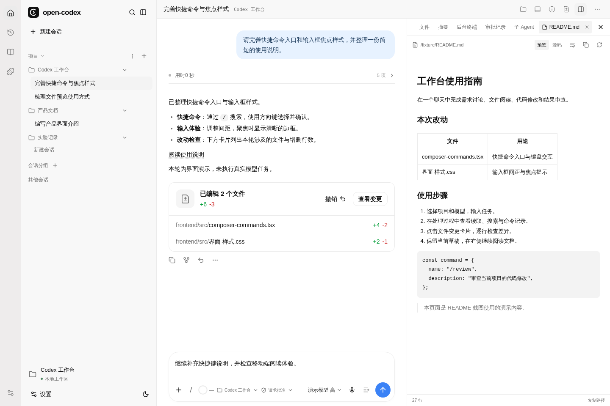

*图 3：点击回复中的「阅读使用说明」打开右侧文件，当前聊天与未发送草稿继续保留。*

顶部 **「打开文件」** 进入目录浏览；点击消息或工具记录中的文件链接，也能直接打开文件。
右侧阅读面板支持多个文件标签、复制内容和路径、刷新、换行，以及源码行号定位。
同一文件重复打开会复用标签，切换标签保留阅读位置。

- **Markdown**：在「预览 / 源码」间切换，文档中的相对链接按所在目录解析。
- **代码与文本**：语法着色、行号和指定行高亮，支持绝对路径、相对路径、中文和空格路径。
- **图片**：支持 PNG、JPEG、WebP、GIF 预览。
- **文件管理**：右侧「文件」入口提供 UTF-8 文本编辑、保存、复制、删除和变化监听；
  删除前需要确认，二进制文件不开放文本编辑。

阅读面板与编辑入口各司其职：点击回复中的文件链接先进入阅读，修改需通过文件编辑操作。
保存前会检查已观察到的外部变化，发现冲突时保留草稿并提示；原生写入接口不保证消除所有并发写入窗口。
Markdown 中的 HTML/MDX 不执行，远程图片不会自动加载，外部网页链接在新标签页打开。

### 6. 文件变更与代码审查：从改动摘要进入逐行检查

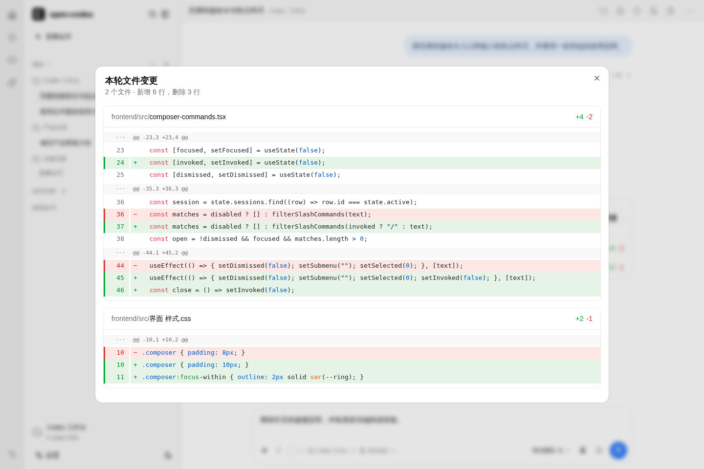

*图 4：从回复下方的「查看变更」打开本轮全部文件差异，绿色和红色分别标记增加与删除。*

当原生运行时报告了文件修改，本轮结束后会在回复下方显示 **文件变更卡片**：
包含文件数量、总增删行数，以及每个文件的路径和增删统计。
点击某个文件只看该文件的差异，点击「查看变更」检查整轮修改；
顶部「查看更改」还可以在右侧面板切换查看不同轮次。

卡片优先使用本轮净变更，不把同一文件的重复修改反复累计。
统计范围是运行时报告的修改，不能据此认定其他进程或 Shell 产生的所有工作区变化都已纳入。
失败或中断的轮次如果已经修改文件，仍会保留变更入口。

**「撤销」需要再次确认**，并校验文件仍匹配本轮结束时的版本。
当前只支持带完整 Git blob 信息的文本补丁；后续编辑、路径越界、不完整版本、重命名、
Windows 或超过 96 KB 的补丁等情况会阻止撤销。撤销文件不会删除聊天记录。
详见 [会话完成后的文件变更](docs/21-turn-file-changes.md)。

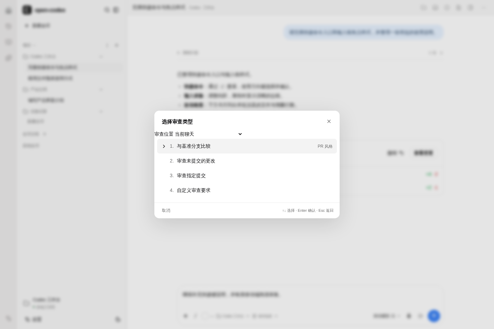

*图 5：`/review` 或「… → 审查更改」打开审查选择器，先明确需要检查的代码范围。*

代码审查提供四种起点：**与基准分支比较、未提交更改、指定提交、自定义要求**。
分支支持搜索，提交列表展示最近 100 条并支持标题或完整 SHA 搜索；
方向键、Enter、Esc 可以完成选择和返回。
可在当前聊天审查，也可选择原生独立审查聊天；后者使用上游已弃用的 detached 模式，
后续升级需重新核对兼容性。查看差异和发起 Agent 审查是两个独立操作。

### 7. 终端与后台任务：保留命令上下文

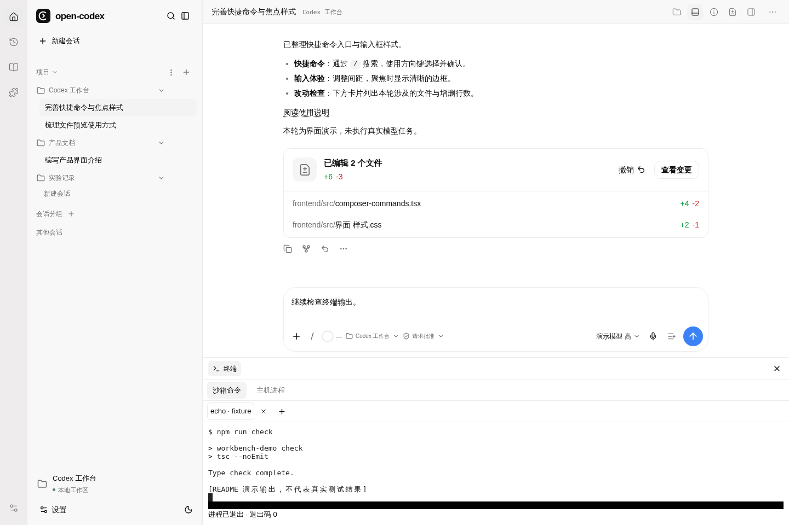

*图 6：底部终端与聊天同时可见。图中的命令输出为截图演示数据。*

顶部 **「打开终端」** 展开底部终端区域。新建终端时可以指定工作目录、程序及参数；
高级执行设置还提供环境变量、超时、输出上限、TTY 和沙箱等原生参数。
终端支持多标签、持续输入、尺寸调整和停止进程，关闭面板后再打开可继续查看已有输出。
刷新恢复会复用原进程身份，具体是否仍可输入取决于进程状态。

| 分类 | 用途与执行边界 |
| --- | --- |
| 沙箱命令 | 使用原生命令执行接口，遵循该请求的沙箱与权限设置 |
| 主机进程 | 使用原生主机进程接口，按其语义不经过 Codex sandbox；选择时需明确所需权限范围 |
| 右侧「后台终端」 | 查看 Agent 启动的后台终端，并按状态停止或清理 |

### 8. 扩展能力：Skills、MCP、Apps 与插件

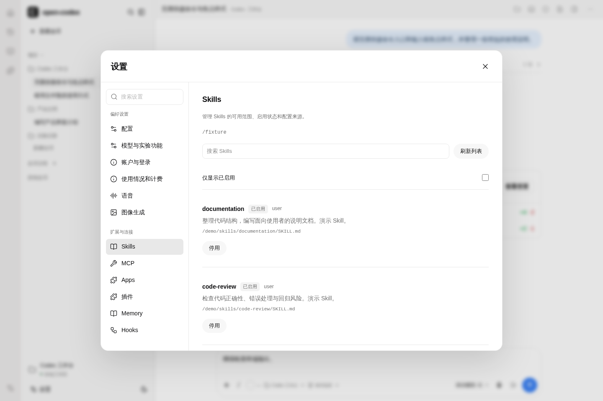

*图 7：Skills 以独立卡片展示，用户可以从设置页发现能力，再将它带回聊天。图中为演示 Skill。*

左下角 **「设置」** 中的「扩展与连接」集中管理外部能力；输入框的引用入口负责在具体任务中使用它们。

| 分类 | 用户可见的功能 | 如何用于聊天 |
| --- | --- | --- |
| Skills | 查看说明、路径、来源、启用状态，管理额外 Skill 根目录 | 在聊天的 Skills 面板点击「在对话中使用」，或在输入框中用 `$` 引用；Agent 也可按任务选择 |
| MCP | 查看服务连接和授权状态、工具 Schema、调用表单、资源及订阅 | 为 Agent 提供外部工具，也可在界面中检查工具和资源 |
| Apps | 查看连接器详情、安装与授权状态，以及可打开的 MCP App | 引用应用能力；有交互视图的工具可直接在页面操作 |
| 插件 | 按原生市场浏览、搜索、查看详情，安装、卸载和同步 | 将插件提供的 Skills、MCP 和 Apps 带入运行时 |

**MCP Apps** 可以把工具结果展示为交互页面：既能内联显示在处理过程内，也能全屏、画中画或固定到右侧。
切换显示方式保留页面状态；应用可以提供表单、工具操作、资源阅读、下载，以及向聊天发送消息或更新上下文。
涉及修改、下载、发送消息等操作时按相应权限流程确认。
交互页面由 MCP 服务提供，Host 负责嵌入和桥接；没有接入服务时，不会自动出现业务仪表盘。
接入与隔离边界见 [通用 MCP Apps Host](docs/18-mcp-apps.md)。

### 9. 设置中心：区分默认配置与当前聊天设置

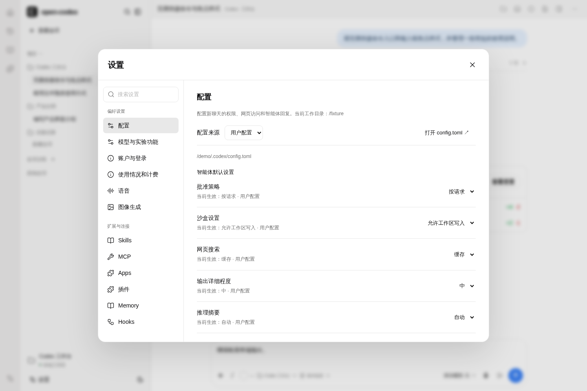

*图 8：配置页同时显示可编辑值、当前生效值和来源，便于判断配置为何被覆盖。*

设置中心采用 **左侧分类导航、右侧内容** 的布局，并提供分类搜索。
日常选项以逐行表单展示，高级选项按需展开。

| 设置分组 | 主要内容 |
| --- | --- |
| 偏好设置 | 默认配置、模型与实验功能、账户与登录、使用情况和计费、语音、图像生成 |
| 扩展与连接 | Skills、MCP、Apps、插件、Memory、Hooks |
| 高级 | 远程控制、执行环境、导入外部配置、高级原生能力、诊断与反馈、快捷命令、能力和开发者工具；Windows sandbox 按主机平台显示 |

**配置页**提供批准策略、沙箱、网页搜索、回复详细程度和推理摘要等常用项，
也覆盖固定版本的 **103 个原生配置域**，可搜索和分类查看嵌套设置。
用户层支持版本化保存；项目、系统与托管层展示内容和来源。
发生版本冲突时保留草稿，重新读取后再决定修改；正式 Release 的配置保持只读。
两个旧 profile 配置项仅支持查看与删除，具体范围见 [原生能力补齐与验收](docs/20-native-capability-completion.md)。

**默认配置主要供新聊天继承**。要改变已有聊天的模型、推理强度或权限，
使用该聊天的输入框及会话设置；保存默认值或触发原生重载，不会把已有聊天全部切换。

账户页接入原生登录、额度和工作区信息；Memory 提供会话模式及重置操作；
Hooks 展示清单、来源和执行记录。远程控制、环境、插件授权等功能以实际服务能力为准，
界面存在相应入口不等于部署环境已具备所需提供方。

### 10. 语音与图像：把多模态能力接入聊天

输入框的 **麦克风** 用于录音并保存为音频附件；聊天空闲、输入框为空且未启用目标输入时，
**蓝色语音按钮** 用于启动原生实时对话。
实时对话提供静音、结束、文字和语音记录；「设置 → 语音」中可选择浏览器输入、输出设备，
以及 WebSocket / WebRTC 等连接参数。麦克风需要 HTTPS 或 localhost 和浏览器许可，
实时语音还依赖模型与服务商支持。

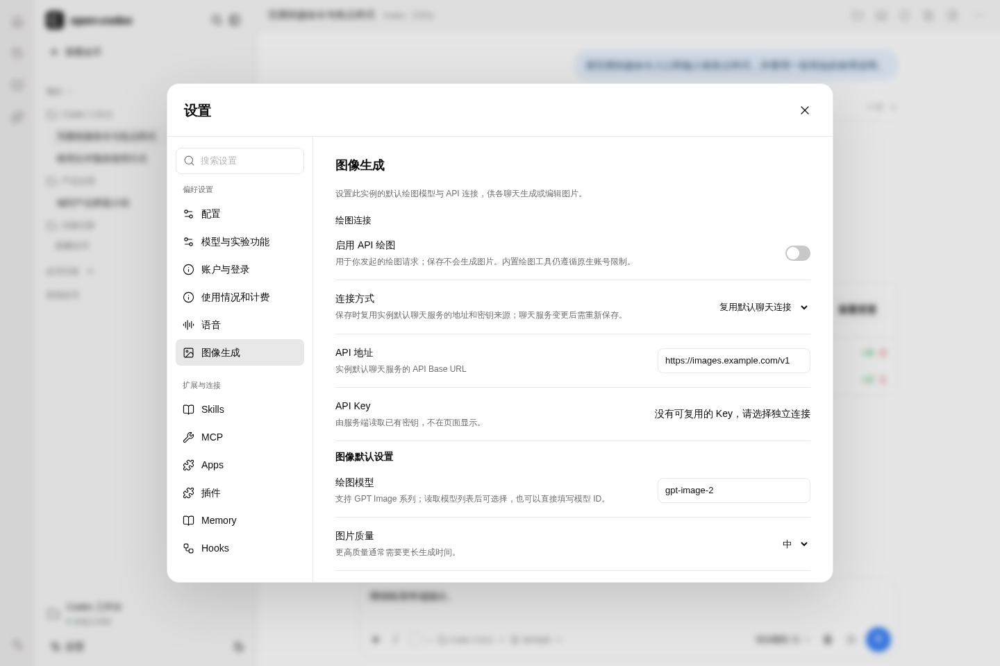

*图 9：独立图像生成设置。此演示未配置密钥、未启用绘图，因此页面明确提示连接条件尚未满足。*

**「设置 → 图像生成」** 提供 API 绘图开关、连接方式、模型、质量和尺寸设置。
可复用默认聊天连接，也可配置独立 Images API；服务端保存密钥，页面不回显已有 Key。
启用并保存后生成 `imagegen-api` Skill，可在聊天中引用 `$imagegen-api` 发起绘图任务。

保存设置不会自动生成图片。「检查连接与模型」用于读取模型及检查图像接口权限，
模型出现在列表中不代表已经具备出图权限；实际调用还受沙箱、网络批准、额度和网关分组权限影响。
更换聊天 provider 后，复用连接的图像设置需要重新保存以同步地址和凭据来源。
完整配置与生效规则见 [图像生成设置](docs/22-image-generation.md)。

### 11. 深色主题与移动端

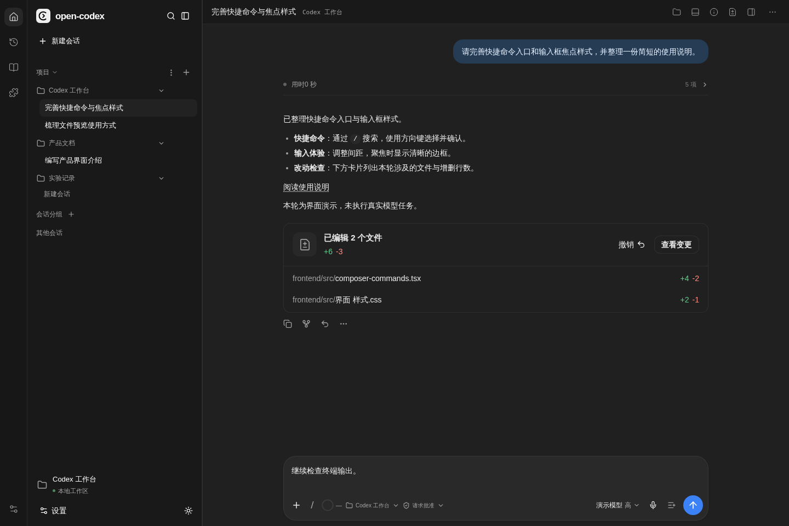

*图 10：左下角主题按钮切换浅色 / 深色外观，偏好保留在当前浏览器。*

桌面端支持聊天、右侧文件或任务面板、底部终端并排工作。
手机端收起侧栏，聊天与输入框适配窄屏，文件、差异和任务详情按弹层方式打开，
可继续阅读、发送消息和处理审批。移动端访问的是同一 Host 的会话，使用原有访问权限。

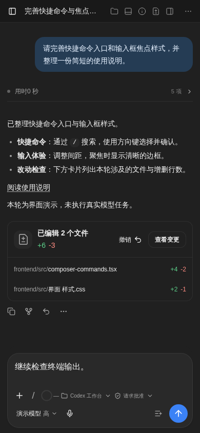

*图 11：手机视口中的同一聊天，保留文件变更入口、项目、权限和模型控制。*

### 12. 第一次使用的推荐路径

1. 按下文启动服务，通过部署地址打开网页；脚本默认端口为 `18880`，本机可访问
   `http://127.0.0.1:18880`。
2. 在项目旁点击「＋」，选择服务器工作目录，再新建会话。
3. 确认输入框下方的项目、权限、模型与推理强度，输入一个范围明确的任务。
4. 按需上传附件、引用 Skill 或使用计划模式；运行中补充要求，后续任务放入队列。
5. 查看过程与审批，完成后点击文件链接阅读结果，打开变更卡片检查差异。
6. 需要进一步检查时启动 `/review`；需要留档时导出 Markdown，完成后归档会话。

更细的功能位置与原生接口见 [Web 能力对齐](docs/17-web-capability-parity.md)，
部署条件见 [配置与部署](docs/06-config-deployment.md)。当前版本提供通用 Agent 工作台；
业务阶段图、训练指标仪表盘和产物面板仍属于后续业务接入范围。

## 启动

在本目录执行：

```sh
sh start.sh
```

脚本在 `.local` 创建独立 Conda 环境，安装本项目依赖与固定版本 Codex，构建前端。首次从 `CODEX_AGENT_AUTH_DIR`（默认 `~/.codex`）复制模型连接与认证；也可提供 `OPENAI_API_KEY`。无需安装 Galatea Python 包或运行训练平台。

首次生成 `.local/agent.json` 与 `.local/codex-home/config.toml`，之后保留用户编辑。`CODEX_AGENT_MODEL`、`CODEX_AGENT_WORKSPACE` 控制首次生成的模型和工作目录，`CODEX_AGENT_HOST`、`CODEX_AGENT_PORT` 控制脚本监听地址。

也可以在任意目录安装、使用独立配置启动：

```sh
python -m pip install -e '.[test]'
codex-agent --config /absolute/path/agent.json serve --dev
```

参考 [agent.example.json](config/agent.example.json) 和 [配置与部署](docs/06-config-deployment.md)。原生配置中的模型、权限和 MCP 继续由 Codex 管理，固定协议版本为 **0.163.0**。

## 接入能力

- **Skill**：在 `agent.json` 中设置 `skills.roots`。每个目录包含若干 `<skill>/SKILL.md`，通过原生 `skills/extraRoots/set` 注册；Codex 仍发现工作区和原生 Skill。页面可选择 Skill，Agent 也可根据任务判断使用。
- **MCP**：在 `codex-home/config.toml` 配置 `[mcp_servers.<name>]`，支持独立 stdio 进程和远程服务。模板见 [mcp.example.toml](config/mcp.example.toml)。Host 不实现上传、训练等业务服务。
- **MCP Apps**：工具声明 `ui://` HTML 资源即可展示交互页面，支持消息/上下文桥、工具与资源、全屏/画中画/右侧固定、下载与权限确认。业务页面由 MCP 服务提供；接入约定和能力边界见 [通用 MCP Apps Host](docs/18-mcp-apps.md)。
- **插件**：设置中的插件页面按原生市场展示目录、详情、Skills、MCP 和应用，支持安装、卸载、同步及授权提示。Skill、MCP 与插件管理的设计对照和验收见 [扩展管理](docs/16-integrations.md)。正式 Release 的配置修改保持只读。
- **自定义 Tool**：通过 `tools.catalog_dir` 和 `tools.providers` 加载独立 Python 扩展。示例见 [echo](examples/echo/provider.py)；未配置时无 Host 自定义工具，原生编码工具仍可用。

例如将以下字段加入 `agent.json`，并替换绝对路径：

```json
{
  "skills": {"roots": ["/absolute/path/skills"]},
  "codex": {
    "binary": "/absolute/path/runtime/bin/codex",
    "runtime_version": "codex-cli 0.163.0",
    "inherit_env": ["EXAMPLE_SERVICE_TOKEN"]
  },
  "tools": {
    "catalog_dir": "/absolute/path/examples/echo",
    "actions": ["echo"],
    "providers": [{"path": "/absolute/path/examples/echo/provider.py", "options": {"prefix": "hello "}}]
  }
}
```

这是配置片段，需要与模板中的 `schema_version` 和 `paths` 合并。外部服务的授权与幂等由服务负责；Host 自定义 Tool 额外提供参数校验、操作日志和未知结果恢复接口。详见 [Tool 扩展契约](docs/03-tool-registry.md)。

## 重构边界

仅接受 `codex-agent/v2` 配置；旧 `principal`、`galatea`、`paths.contracts` 和固定工具目录已删除。旧配置不会自动迁移，已有文件不会被覆盖。升级应新建配置和状态目录，重新配置业务扩展；旧部署的接纳证据不能用于新版本。

当前网页保留通用对话、模型/权限设置、文件与终端、Skill/MCP、审批、事件和会话恢复。业务节点的定义与判断交给 Agent 和 Skill；业务阶段图、训练仪表盘和产物面板留在第二阶段。

## 项目与权限交互

侧栏的 `＋` 可添加服务器上的已有目录，或创建文件夹作为项目。`…` 可创建、重命名分组；
项目、分组和会话支持拖动排序，项目菜单也提供上移、下移和移动分组。
桌面端可拖动会话列表右边缘调整宽度，双击恢复默认；宽度保存在当前浏览器，收拢后重新展开也会保留。
每个项目有独立 ID 和名称，多个项目可以选择同一个文件夹，会话归属不按目录合并。
会话列表、聊天记录、模型与项目目录独立加载，已到达的内容立即展示，其余信息在后台补齐；
切换会话时聊天记录不等待健康检查，发送操作仍等待当前会话状态核对完成。
项目名称、多个工作目录、项目顺序和会话归属使用原生项目协议保存；项目分组名称与顺序由同一 Host 共享保存。
折叠状态和本地展示偏好仍保留在浏览器。旧 localStorage 项目通过原生 `project/import` 幂等迁移。
非项目会话另用原生会话分组。共享范围是同一个 Host / Codex Home，不承诺跨主机同步。
编辑项目可增加、移除、调整工作目录，第一个目录用于新聊天。
跨项目拖动会话、输入框下方切换项目都会通过 `thread/settings/update` 更新该会话后续任务的工作目录；
正在运行的会话需结束回复后才能移动。

输入框下方的权限菜单直接切换「请求批准」「帮我批准」「完全访问权限」，`/permissions` 打开同一个菜单。
设置使用原生 `approvalPolicy`、`approvalsReviewer` 和 `sandboxPolicy`；新会话在创建时传入对应权限，
已有会话更新成功后才改变显示，原生拒绝时保留原设置。自定义权限以「自定义权限」显示。
输入框 `＋` 提供文件上传、目标、计划模式，以及 Apps、插件、Skills 引用列表。
在输入框中键入 `$` 可搜索当前工作目录的可用 Skill；用 ↑/↓ 选择、Enter/Tab 确认，也可直接点击。
选中后当前 `$关键词` 转为可移除的引用标签；Esc 关闭候选列表，未选择的文字保持原样。
引用以标签随下一条消息发送；目标与计划输入模式互斥，目标只接受文字。
待发送消息以窄条贴在主输入框上方，显示预览和删除按钮，点击消息可编辑，更多菜单可排序或立即发送。
运行中 Enter 补充当前回复（steer），Tab 将内容加入队列；也可点击输入框内的队列按钮。
快捷键沿用仓库原生 CLI 默认绑定，Skill 和斜杠菜单补全优先；队列由原生运行时在聊天空闲时依次发送。
目标卡片在输入框上方，文件、审批记录、后台终端和子 Agent 在聊天右侧。
`/review` 或「… → 审查更改」打开 CLI 风格的审查选择器：与基准分支比较、未提交更改、指定提交、自定义要求。
支持 ↑/↓、Enter 和 Esc；分支可搜索，提交显示最近 100 条并支持标题或完整 SHA 搜索，可选择当前聊天或原生 detached 独立审查聊天。
麦克风录音作为音频附件，蓝色语音按钮启动原生实时对话。终端提供沙箱命令与主机进程两个标签。
完整功能位置、原生接口与验收边界见 [Web 能力对齐](docs/17-web-capability-parity.md)。
设置现含全部 103 个原生配置域、账户与登录、聊天资源及高级原生参数；
逐项能力清单、配置集上游限制和验证结果见 [原生能力补齐与验收](docs/20-native-capability-completion.md)。
图像生成设置和 API Skill 的连接、密钥保护及网关权限边界见 [图像生成设置](docs/22-image-generation.md)。

聊天右上角「… → 复制」提供深度链接、整段会话 Markdown 和工作目录复制；「导出 Markdown」
将同一份会话内容下载为 `.md` 文件。导出会读取当前 Host 的全部历史分页，保留 Markdown 原文、
公开思考摘要、工具记录与附件引用；附件二进制不打包。回复仍在进行或部分历史不可用时，文件中会注明。
深度链接打开同一 Host 上的指定会话，仍需要原有访问权限。

## 验证

```sh
python -m unittest discover -s tests -p 'test_*.py'
cd frontend
npm test
npm run build
```

真实原生协议验证通过 `CODEX_TEST_RUNTIME_PACKAGE=/absolute/path/runtime` 开启，使用本地模拟 Responses 服务与 MCP echo 进程，不调用付费模型或实际训练。完整说明见 [测试验收](docs/09-test-acceptance.md)。

开发模式不要求部署接纳文件。正式启动仍要求 runtime 来源、协议、扩展和恢复证据；参见 [生产状态](docs/12-production-readiness.md)。
