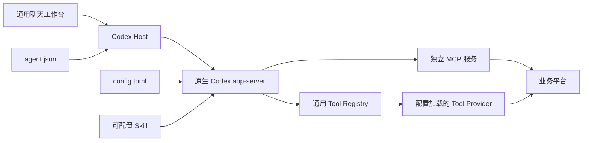

# 通用 Host 架构

Codex 是唯一 Agent Runtime，负责模型调用、Agent Loop、Thread/Turn、Skill、原生工具、沙箱和审批。Host 通过 stdio JSON-RPC 管理原生进程，不根据训练状态决定下一节点，不内置 Galatea Service、项目、实验、数据集、Ray、MLflow 或 MinIO 客户端。

Host 负责运行时进程、JSON-RPC、会话准入、审批响应、持久化操作身份和通用事件。业务能力来自工作区/外置 Skill、原生编码工具、配置的 Python Tool Provider 或 MCP 服务。

MCP 可以部署在远端，也可以作为独立 stdio 子进程启动；两者都不属于 Host 的业务实现。Python Provider 是管理员安装的进程内扩展，适合需要 Host 调用日志和恢复钩子的工具。

当前交付通用执行链路；业务适配、阶段和产物投影属于后续接入范围，不把业务流程改写为 Host 固定状态机。自定义节点可由 Skill 描述并由 Agent 判断进入、回退和继续。

仓库没有内置 Galatea Provider；需要单独配置外部 MCP，或实现并验收独立 Provider。项目 YAML 固定入口与 MCP Campaign 服务是两条独立治理路径，不能混用状态与授权。Host 不消费 `wait_external` 作为调度事件，通用会话恢复也不等于外部训练恢复。完整边界见 [Codex 与 Galatea 架构](../../../doc/agent-galatea.md)。
