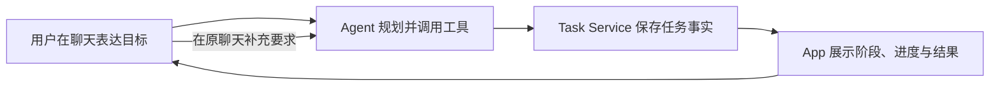
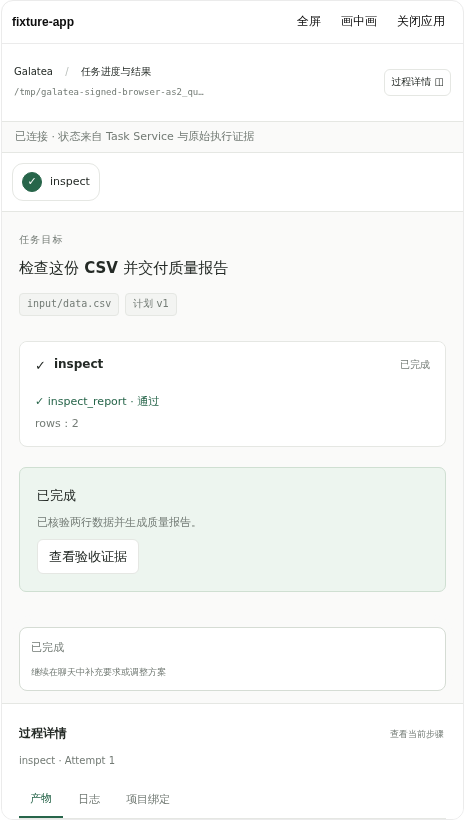

# Galatea 任务 App 产品介绍

Galatea 任务 App 把 Agent 执行过程变成可查看的阶段、进度和交付结果。
**聊天是入口，Agent 主导执行，App 是按任务需要自动展开的展示面板。**
用户在原聊天提出目标、补充约束和调整方向，无需再进入 App 填写一份任务表单。

## 如何使用

1. 在已接入 Galatea App 的 Host 中新建聊天，选择任务所在工作目录。
2. 直接描述需求，例如：“检查 input/data.csv 的缺失值和重复行，生成报告，不修改原文件。”
3. Agent 识别任务、建立与当前聊天绑定的 Task，并按需要制定阶段。工具调用成功后，
   Host 自动展开 App；用户可以同时看到聊天中的执行说明和面板里的任务进展。
4. 在原聊天继续补充要求，例如“再按列统计缺失比例”。Agent 据此调整计划，
   App 展示更新后的阶段及结果。
5. 完成后在面板查看指标、报告和可预览产物，也可以继续围绕结果提问。

App 内没有发起表单、项目列表或第二个聊天框。Host 侧栏仍负责项目与聊天导航；
`/apps`、`/mcp` 可用于查看接入情况，普通任务不需要手动打开 App。

## 面板能展示什么

| 内容 | 用户可以了解的事情 |
| --- | --- |
| 任务目标与状态 | 当前执行哪项需求，正在进行、等待处理还是已完成 |
| 动态阶段 | 已完成的步骤、当前步骤和后续计划；阶段可随任务调整 |
| 执行进展与日志 | 已记录的执行事实和等待原因；没有依据时不虚构完成比例 |
| 指标与结果 | 数据统计、验证结论，以及任务产生的可核验报告和产物 |
| 必要确认 | 需要训练时核对具体方案、预算和已有授权范围 |

数据检查可能只有“检查”和“报告”两个阶段；发现质量问题后可以增加修复阶段。
训练任务按实际需要展示准备、方案、外部执行和结果验证，页面不强制每个任务走同一套流程。
任务完成由服务校验证据，不能把 Agent 回复结束当成业务已经成功。

*任务面板示例：使用受控模型响应和真实 Host、AppBridge、SQLite 的浏览器验收截图。
模拟数据不作为真实模型决策或训练结果的证据。*

## 聊天与 App 如何协作

聊天承载目标、讨论与决策，App 展示结构化状态。收起面板或切换标签后可继续查看同一任务；
刷新页面时，从原聊天的工具记录和服务端快照恢复。新聊天查询自己的任务绑定，
不会自动把历史任务的结果当作本次交付。

关闭页面不删除任务。已受理的外部任务由后台服务继续观察；
这不代表浏览器关闭后所有本地 Agent 操作都会继续执行。

## 职责边界与耦合

这套设计存在必要的协议依赖，业务逻辑通过独立服务隔离：

| 角色 | 职责 | 与其他部分的连接 |
| --- | --- | --- |
| Codex Agent | 理解目标、规划、选择工具、根据事实决定下一步 | 原生工具、Skill、MCP 或可选 Provider |
| 通用 Host | 管理原生会话、签名调用、展示 App、恢复视图 | 工具回执中的 `app_view` 与 MCP AppBridge |
| Task Service | 保存 Task、阶段、证据，校验权限与状态变更 | 工具契约、任务快照与事件 |
| App | 渲染任务状态、预览产物、提交允许的确认操作 | 通过 Host 调用服务，不自行启动模型循环 |
| 外部执行与观察 | 受治理地执行训练、查询外部状态、请求原会话接续 | 固定项目入口或 Campaign MCP，以及通用 Host 接续接口 |

Host 理解通用的 App 展示契约，不定义 CSV 或训练阶段；App 不根据聊天文案猜测任务是否完成。
部署时仍需配置 Provider、MCP、身份和凭据，因此它们不是完全独立、零配置的组件。
工具名、快照字段或展示契约变化时，需要一起验证兼容性。

## 已验证范围

2026-10-19，普通 CSV 需求已在真实模型和浏览器中完成“同一聊天提出需求 →
自动展开 App → 更新进度 → 交付可核验报告”，并在主入口端口 18880 复核。
验证包含刷新恢复、任务隔离和源文件未被修改；这次交互验收没有执行训练。

训练操作仍须精确方案确认及匹配的治理授权。页面确认不新增 Release 权限或 GPU 预算，
也不等于最终测试或模型推广授权。模拟场景、历史训练证据与真实会话结果分别记录，
完整证据与限制见[实施与验收记录](10-implementation-acceptance.md)。

## 继续阅读

- [运行、接入与运维](../README.md)
- [产品范围与使用流程](01-product-and-scope.md)
- [App 界面与交互](06-app-experience.md)
- [接口与可信调用](04-interfaces-and-trust.md)
- [完整技术方案](README.md)
