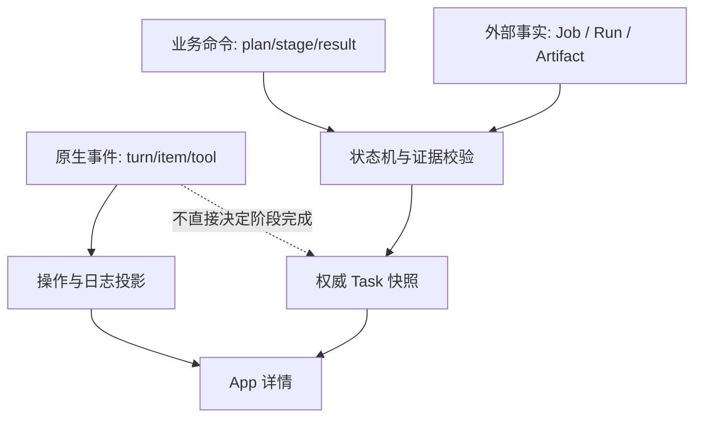

# 02 架构与现有能力

## 1. 组件职责

| 组件 | 拥有的状态与职责 | 不承担的职责 |
| --- | --- | --- |
| Codex Runtime | 推理、规划、Skill 使用、原生工具执行与原生会话 | 业务事实数据库与独立后台 Job 观察 |
| 通用 Host | 会话创建/激活、权限、AppBridge、公开消息/事件导出、请求收据 | Galatea 阶段、训练预算、Campaign 业务规则 |
| Galatea MCP App | 完整工作台：导航、同源对话、动态阶段/过程卡、预算、文件 diff、三类详情、输入 | Agent Loop、可信身份声明、任务最终状态裁决 |
| App MCP 服务 | `ui://` 资源、App 工具、结果与快照序列化 | 第二个模型客户端 |
| Task Service | 项目登记、Task/Stage/Attempt、方案待办、状态机、证据与 WorkbenchView 投影 | 自行生成计划或改写训练治理事实 |
| Task Tool Provider | 将 Host 提供的可信 ToolContext 转为 Task Service 内部调用 | 读取任意模型参数作为身份或批准凭证 |
| Integration Worker | 外部状态观察、证据验证、Outbox 投递、确定性恢复 | 推理下一阶段、自由调用模型、绕过原生 Host |
| Governance Adapter | 显式选择治理路线，规范化查询、已授权操作与确定性恢复 | 混合两套治理系统、在线伪造授权 |

Task Service、App MCP 和 Worker 可在第一版作为一个 Python 包、一个服务进程的模块，
共享单个数据库，Worker 使用有期限的租约。保留接口边界，先不拆成微服务。
App 前端为独立 TypeScript 构建，HTML/脚本随 MCP 资源交付。

## 2. 当前能力与新增缺口

| 能力 | 当前状态 | 本方案工作 |
| --- | --- | --- |
| `ui://` HTML、AppBridge、主题与显示模式 | 已有 | 复用并做 Galatea 联调 |
| 同服务工具/资源调用、非只读工具确认 | 已有 | 增加可信调用收据，不能仅使用前端确认布尔值 |
| `ui/message`、`ui/update-model-context` | 已有 | 复用；前者触发/引导 Agent，后者只更新上下文 |
| 原生 Codex 会话和动态工具 Provider | 已有 | 新增外置 Task Provider，显式配置工具目录 |
| Task/Stage/Attempt 持久化与动态计划 | 没有 | 新增 Task Service |
| 原生运行事件与公开消息 | 已有原生数据，App 无完整读取接口 | 新增通用持久化导出、消息去重及工作台时间线投影 |
| App 项目导航与自动会话切换 | 无完整业务实现 | 项目登记、受限目录分配、可信 Host 激活与 iframe 重新挂载 |
| 文件列表与面板内 diff | 有原生文件变更信息，缺 App 读取模型 | 新增不可变变更快照、受控分页读取与检查结果关联 |
| 完整预算卡与三种决定 | 无工作台方案契约 | 新增 TrainingProposal/待办/digest；确认只消费既有治理授权 |
| 浏览器关闭后的外部任务观察 | 没有业务实现 | 新增 Worker 和外部适配器 |
| 可信后台接续入口 | 没有完整业务入口 | 新增通用 Host continuation API、去重与恢复 |
| 训练 Campaign 治理 MCP | 已有独立服务 | 按能力集接入，保留授权与写锁边界 |
| App 在线批准新训练预算 | 没有 | 首版使用已有授权，后续独立治理扩展 |
| 资源订阅推送、sampling、自定义 App 工具注入模型 | 当前 Host 未支持 | 首版不用，采用短轮询和配置的 Provider |

“已有”仅指当前代码提供基础机制，不代表 Galatea 端到端业务已经验收。

## 3. 为什么 Agent 写工具采用 Provider

原生外部 MCP 调用不会自动经过 Host 的 Dynamic Tool Registry，也不会自动携带
可信的 `session_id/thread_id/turn_id`。App 或模型提交的 `_meta`、工具参数同样不能证明身份。

因此第一版采用两个入口连接同一 Task Service：

1. **Agent 写入口**：配置式 Task Tool Provider，由 Host 构造可信 `ToolContext`。
2. **App 入口**：MCP App 工具，经 Host 可信调用网关注入签名的调用上下文；
   写操作额外绑定用户确认收据。

Provider 代码位于 `galatea-app` 集成目录，Host 不导入 Galatea 业务包。
Host 只复用已有 Provider 契约，增加通用事件、可信交互和接续能力。
处理数据和训练仍通过 Skills、原生工具及治理入口进行，Task Provider 只管理任务协议。

这不改变 MCP App 的产品形态。如果未来外部 MCP 传输具备可靠的身份与会话证明，
可以给相同 Task 命令增加 MCP Agent 写入口；首版不假设该能力存在。

## 4. 三类事实的边界



原生 `turn/plan/updated` 中只有文本步骤和状态，没有稳定业务阶段 ID。
可以把其公开计划放入“Agent 当前计划”详情，但不能导出内部推理或同步覆盖业务阶段。
原生 `turn/completed` 仅代表本轮 Agent 结束，可能仍有外部 Job 在运行。

## 5. 代码放置建议

以下是待创建的实现目录，本次交付只新增 `docs/`：

```text
agents/galatea-app/
  docs/
  frontend/                    # MCP App UI、组件注册表、SDK 接入
  src/galatea_app/
    domain/                    # 命令、状态机、证据与计划校验
    storage/                   # SQLite、迁移、事务与 Outbox
    mcp/                       # UI 资源、App 工具
    api/                       # Provider / Worker 内部接口
    projections/               # 同源对话、过程卡、文件变更与 WorkbenchView
    integrations/
      codex_provider.py        # 管理员配置的 Host 插件
      host_events.py           # 可信运行事件 -> Task 事件
      host_activation.py       # 目录/会话初始化与可信激活对账，不调用模型
      governance_mcp.py        # 外部 Campaign 路线
      project_governance.py    # 项目 YAML 路线
      evidence.py              # 受限证据与制品读取
    workers/                   # 外部观察、验证、接续投递
  contracts/                   # 从设计协议落实为运行时 Schema
  tests/
  deploy/                      # 无秘密的配置模板与运维说明
```

## 6. 可核对的源码依据

| 结论 | 源码或文档 |
| --- | --- |
| AppBridge 作用域与确认、消息、上下文 | [mcp-app-view.tsx](https://github.com/lunasaw/open-codex/blob/6ef38b998b465eadf1295b8d30378747c62d2ba8/frontend/src/mcp-app-view.tsx) |
| Apps 原生目录与 MCP App 的区别 | [apps-panel.tsx](https://github.com/lunasaw/open-codex/blob/6ef38b998b465eadf1295b8d30378747c62d2ba8/frontend/src/apps-panel.tsx) |
| iframe 与资源读取、消息入口 | [console/server.py](https://github.com/lunasaw/open-codex/blob/6ef38b998b465eadf1295b8d30378747c62d2ba8/src/codex_agent/console/server.py) |
| App 上下文是 untrusted | [mcp_app_context.py](https://github.com/lunasaw/open-codex/blob/6ef38b998b465eadf1295b8d30378747c62d2ba8/src/codex_agent/mcp_app_context.py) |
| ToolContext、工具日志与恢复 | [registry.py](https://github.com/lunasaw/open-codex/blob/6ef38b998b465eadf1295b8d30378747c62d2ba8/src/codex_agent/registry.py) |
| Provider 仅有 handlers/reconcile/observe_receipt/close | [providers.py](https://github.com/lunasaw/open-codex/blob/6ef38b998b465eadf1295b8d30378747c62d2ba8/src/codex_agent/providers.py) |
| 请求收据与原生调用绑定 | [host.py](https://github.com/lunasaw/open-codex/blob/6ef38b998b465eadf1295b8d30378747c62d2ba8/src/codex_agent/host.py) |
| 运行事件队列与持久化投影 | [console/service.py](https://github.com/lunasaw/open-codex/blob/6ef38b998b465eadf1295b8d30378747c62d2ba8/src/codex_agent/console/service.py) |
| 原生事件投影与计划 | [console/projection.py](https://github.com/lunasaw/open-codex/blob/6ef38b998b465eadf1295b8d30378747c62d2ba8/src/codex_agent/console/projection.py) |
| 本地协议基线 | [0.163.0.json](https://github.com/lunasaw/open-codex/blob/6ef38b998b465eadf1295b8d30378747c62d2ba8/src/codex_agent/protocol/0.163.0.json) |
| 最小 MCP App 包装示例 | [Hello World MCP](https://github.com/lunasaw/open-codex/blob/6ef38b998b465eadf1295b8d30378747c62d2ba8/examples/hello-world-mcp/README.md) |

当前 Provider 没有原生事件订阅钩子。事件导出须作为新的通用 Host 扩展实现，
不能在方案中假装 `ToolProvider` 已提供此功能。

## 7. 关键架构决策

- **ADR-01：单一 Agent Runtime。** Worker 只处理确定性状态、验证和投递，不调用模型 SDK。
- **ADR-02：Task 与 Campaign 分离。** 同一个任务可以完全没有训练相关实体。
- **ADR-03：证据优先。** 阶段完成经服务校验；原生事件只解释执行过程。
- **ADR-04：计划可修订、历史不可擦除。** 已完成阶段与尝试记录不可原地改写。
- **ADR-05：首版串行执行。** 降低事件归属、取消和预算并发的复杂度。
- **ADR-06：可靠性采用至少一次投递与幂等。** 不宣称数据库、原生进程和 Ray 之间存在分布式原子事务。
- **ADR-07：读写都绑定可信主体。** UI visibility、readOnlyHint、App 参数不能替代后端权限校验。
