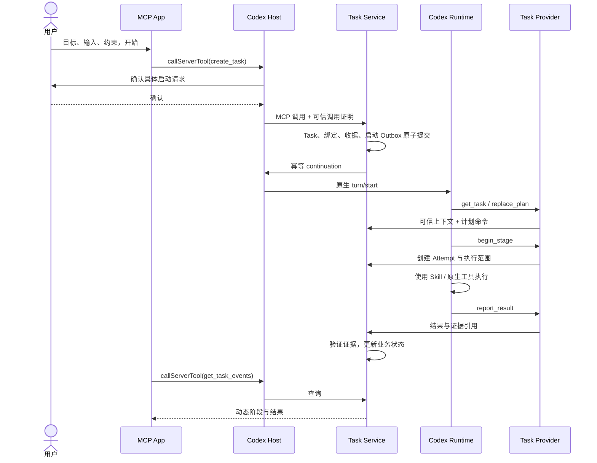
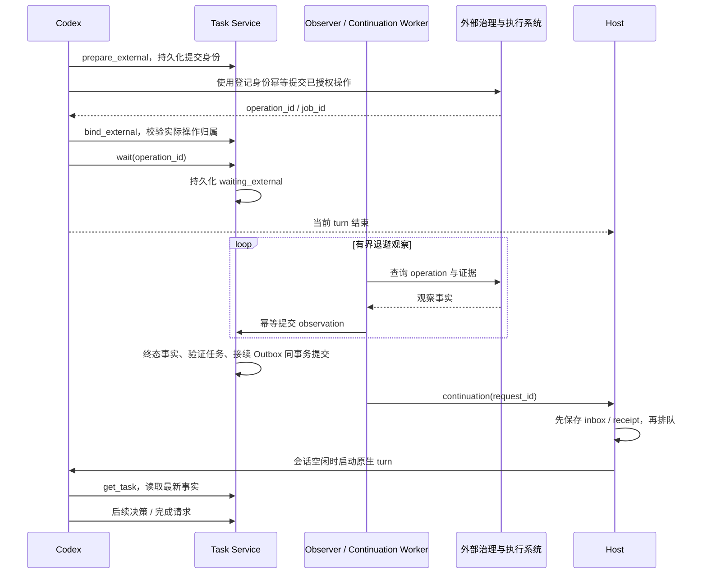

# 05 Agent 执行与后台接续

## 1. 从目标到执行

用户通过 App 确认启动时，Host 记录精确目标、输入引用和约束的交互收据。
Task Service 创建 TaskBinding、授权范围、持续执行策略与首条 continuation Outbox。
Worker 将启动事实投递给 Host，Host 启动原生 Codex turn。

也可从普通聊天进入：Agent 创建 Task 草稿并展示 App，用户在 Host 确认任务范围后启动。
首版不把模型转述的“用户同意了”自动转换成后台持续执行授权。
已有确切授权的集成将来可以接收 Host 生成的请求引用；不能仅由工具参数宣称有授权。



图中的服务端接续由 Worker 执行，Task Service 自身不调用模型。
`create_task(start=true)` 已经生成启动请求后，App 不再额外发送同一条 `ui/message`，
避免一次用户动作启动两个 turn。

## 2. Agent 执行契约

新增 repository Skill `galatea-task-workflow`，按原生 Skill 机制发现和加载。
它描述协议和结果要求，不把某个项目的五个阶段写进系统提示词。
真正的数据准备或训练行为仍路由至对应项目 Skill；训练使用现有受治理流程。

Agent 每轮执行遵循：

1. 读取任务、能力和最新计划；确认当前 turn 绑定的活动任务。
2. 目标或事实有变化时提交计划修订，说明原因。
3. 选取依赖满足且权限有效的一个阶段，调用 `begin_stage`。
4. 在约束内使用 Skill、文件、Shell、MCP 或固定执行入口完成工作。
5. 提交产物引用、结构化结果和验收所需证据；读取服务的验证结论。
6. 继续下一阶段，或登记具体等待条件后结束 turn。
7. 必要阶段完成后调用 `complete_task`，以服务确认结果作为最终状态。

以上流程需由状态机、能力限制和执行令牌约束。Skill 提示能引导模型，但不是权限实现。
Agent 绕过 Task 工具执行的原生命令只能作为未关联操作记录，不自动获得阶段成功证据。

第一版不为同一 Task 并行运行多个 Agent，不为等待外部结果保持无限运行的 turn。

## 3. 原生事件关联

Host 持久化导出以下允许字段：host_id、session_id、thread_id、turn_id、item_id、
native_call_id、journal_call_id（如有）、事件类型、状态、脱敏摘要、时间与源序号。
不得导出思维链、认证令牌或未过滤的完整工具参数。

`begin_stage` 建立 execution scope，关联 task/stage/attempt、Host 实际 turn 和起始事件位置。
结束或等待时关闭 scope。Task Provider 命令和 Host 原生事件可能跨网络乱序：

- 先持久化原始事件，等 scope 可用后再投影；不能按接收时间猜归属。
- 一次 turn 可以顺序包含多个阶段，以可信 begin/end 边界及 call 映射划分。
- 首版只关联明确 scope 内的工具事件；边界不明的事件显示在任务级“未关联操作”。
- 等待外部工作时不依赖时间窗口，而使用明确的 operation_id/job_id/run_id 绑定。
- 事件存在缺口时标记 coverage 不完整，不能声称日志覆盖完整执行。

现有 Console observer 负责轻量捕获并排队，不能在捕获回调中发网络请求。
新增导出器从持久化 Console 事件按游标读取，网络投递在独立 Worker 完成。
源事件 ID 使用 `{host_id, epoch, seq}`，Task Service Inbox 去重；确认写入后推进游标。
没有持久化 Console 存储的部署不满足后台完整恢复验收。

## 4. 外部长任务

Agent 在外部提交前先调用 `prepare_external`，持久化 intent_id、治理路线、项目、
Campaign、step_id、attempt、Release/config 与输入 digest，以及外部幂等键。
`prepare_external` 只做意图登记与检查，不调用训练入口，也不创建训练授权。
然后使用已有治理工具生成 plan 并提交；返回后 `bind_external` 绑定真实 operation，
再调用 wait。外部返回丢失时，以持久化意图查询原操作并对账，不依赖模型记忆恢复：

```json
{
  "kind": "external",
  "provider": "governance_mcp",
  "operation_id": "operation_demo",
  "success_condition": "operation_succeeded_and_evidence_verified",
  "deadline_at": "2026-10-19T08:00:00Z",
  "resume_policy": "within_task_authorization"
}
```

`success_condition` 是已登记策略标识，不能是模型提供的任意代码或查询表达式。
服务校验 operation 属于当前任务、Attempt、项目、授权和输入 digest。



对于现有外部治理 MCP，逻辑身份至少包括 project/campaign/step/attempt 和不可变输入，
对应实际工具的 `galatea_plan_run`、`galatea_submit_job` 参数；不要自造 operation ID 算法。
响应丢失时通过 `galatea_list_operations` / `galatea_get_operation` 找回并核验，
不存在明确证据时保持 unknown。首次提交前的意图不等于已经受理，不能仅因存在意图就自动启动训练。

外部成功可以触发服务端产物校验；验证完成后再唤醒 Agent 继续分析。
失败或未知也可以触发一次受限的诊断接续，不等同于授权自动重新训练。
浏览器不参与上述闭环。

## 5. Outbox 与接续幂等

接续的 dedupe_key 由 `task_id + wait_id + terminal_observation_version + control_epoch`
构造。相同事实不会产生多个有效接续。不同观察只有在状态或需要处理的信息发生变化时才唤醒。

Task Service 事务写 Outbox，Worker 重试投递同一个 request_id；Host Inbox 去重，
再复用现有 `send_message` 的持久化请求收据。`clientUserMessageId` 仅作关联，
不能假定原生运行时会基于它提供跨崩溃的 exactly-once。

Host 在调用原生 turn/start 后失去连接，可能已经启动也可能未启动：

1. 将接续标为 unknown，停止自动重发。
2. 查询持久化请求日志、原生 thread 状态、turn 与消息关联记录。
3. 证实已启动则回填收据；证实未启动且安全时恢复排队。
4. 无法确认则 Task blocked，展示具体待处理事项，保留全部关联信息。

不得通过“超时换一个 request_id”绕过去重。系统提供至少一次投递加业务幂等，
对无法确认的副作用明确停下，不承诺分布式全局恰好一次。

## 6. 用户输入、暂停与取消

普通“请解释这个结果”可使用现有 `ui/message`，由 Host 确认后 start/steer。
改变目标、处理等待输入、暂停或取消使用结构化 App 写工具，先改变 Task 状态再接续。
`ui/update-model-context` 只传当前选中项和摘要，不能触发执行或确认批准。

暂停按安全边界生效：

- 马上阻止 begin_stage 和新外部提交；撤销尚未启动的 continuation。
- 当前阶段若可以安全终止则请求终止，否则继续观察直到安全边界，再进入 paused。
- 对不支持暂停的外部 Job 展示“停止后续步骤，当前作业继续观察”，不能显示为冻结。
- 恢复要重新检查授权有效期、输入与计划版本。

暂停请求即递增 control_epoch 阻止新命令；需要排空的当前 Attempt 单独登记 draining 范围，
只接收该次执行的结果与观察，不允许它启动新操作。待当前执行明确收敛再显示 paused。
已经由治理系统受理但处于 pending 的操作也属于当前执行，原有恢复可能使它开始运行，
界面必须明确这一点；用户要阻止它启动应选择取消，而不能依赖不受支持的外部暂停语义。

取消按以下顺序实施：

1. Task 进入 cancelling，递增 control_epoch，使旧令牌和未投递接续失效。
2. 通用 Host 取消队列项，并按原生能力中断对应活动 turn。
3. 通过对应治理入口请求停止活跃外部操作；禁止直接绕开治理终止关联不明的任务。
4. 继续对账；确认没有活跃执行后才进入 cancelled。
5. 迟到结果记录为取消后的观察，不重新打开任务，不启动下一阶段。

取消请求与实际停止不原子。提交与取消竞态须使用 operation reservation 和幂等键：
取消后收到新 operation_id 仍要保存并发起停止观察，不能丢掉造成孤儿 Job。
执行侧无法识别 control_epoch 时不能承诺瞬时阻断，UI 必须显示仍在确认停止。

原生 Shell 和外部 MCP 不会因 Task 令牌失效自动禁止执行。完整训练上线必须通过部署权限
限制提交入口，并在对应治理路线实施撤销屏障。外部 Campaign 路线首版让一个活动训练 Task
独占其 Campaign 控制权，取消时调用 `galatea_cancel_campaign` 阻止旧 turn 再提交；
共享 Campaign 只能观测，不能承诺任务级取消完整隔离。项目 YAML 路线须单独验证撤销方式。

## 7. 恢复矩阵

| 故障 | 恢复动作 | 禁止行为 |
| --- | --- | --- |
| App 刷新或关闭 | 重读快照与事件游标 | 从浏览器状态重建业务事实 |
| Worker 在观察后崩溃 | 重复观察，Inbox 去重 | 把重复完成当成再次训练信号 |
| 数据库提交后投递失败 | Outbox 退避重试原键 | 丢弃已提交任务 |
| Host 离线 | 有期限排队，恢复后核对 binding | 启动另一个模型客户端 |
| Host busy | 排队等 ready，用户输入优先 | 后台任意 steer 用户轮次 |
| 原生调用结果未知 | 请求/会话/外部身份对账 | 猜测失败并重发写入 |
| 外部查询 404 或超时 | 标记未知/过期并继续受限对账 | 认定从未执行 |
| Agent 未调用 wait 就结束 | 扫描已绑定 operation；其余标记未闭合 Attempt | 按 turn 结束自动完成 |
| Provider 写入成功但返回丢失 | observe_receipt 查询 Task 收据 | 换 command_id 重新写 |
| 授权过期 | 保持观察，阻止新副作用，等待续授权 | 自动延长授权 |

## 8. 自主运行预算

任务保存最大接续次数、总墙钟时间、允许动作和费用边界；训练预算由治理系统单独执行。
示例起始值为每任务最多 20 次自动接续、连续基础设施失败最多 5 次、任务期限 24 小时，
这些是可配置的产品默认建议，不是现有运行参数。

达到限制后进入 blocked 或 waiting_approval，并说明尚未完成的工作；不能伪报完成。
对仍在运行的外部操作保留必要观察与停止处理，不能因为接续额度用尽就失去追踪。
只在状态变化、完成、失败或需要用户决定时通知，不以每次轮询打扰用户。
