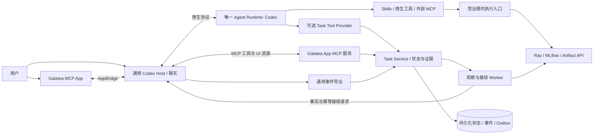

# Galatea 动态 Agent 工作台技术方案

版本：`galatea-app/design-v1`

日期：2026-10-19

状态：待实现的技术设计；不是已经部署或通过业务联调的产品说明。

目标是把现有训练工作台交互原型实现为真正的 MCP App：用户提出目标，Codex
自主规划和执行，界面按当前任务的阶段展示进展。数据处理可以只有两个阶段；
发现数据问题时可以插入修复阶段；需要训练时再接入训练治理。

**核心决策：Codex 决定下一步，Task Service 持久化事实并校验约束，MCP App 渲染动态状态。**
阶段不是前端写死的流程，也不是另建一个调用模型的 Python Agent Loop。

## 阅读顺序

| 文档 | 回答的问题 |
| --- | --- |
| [01 产品范围与使用流程](01-product-and-scope.md) | 动态是什么意思，用户能做什么，第一版交付什么 |
| [02 架构与现有能力](02-architecture.md) | 复用哪些代码，新增哪些组件，为什么这样划分 |
| [03 领域模型与状态机](03-domain-and-state.md) | Task、Stage、Attempt、证据与计划版本如何工作 |
| [04 接口与可信调用](04-interfaces-and-trust.md) | App、Agent、Host、服务之间如何调用和鉴权 |
| [05 Agent 执行与后台接续](05-execution-and-continuation.md) | 自主规划、运行事件、长任务、崩溃恢复如何闭环 |
| [06 App 界面与交互](06-app-experience.md) | 两阶段、动态插入、训练与结果如何统一呈现 |
| [07 训练治理与证据](07-training-and-evidence.md) | 如何接 Ray/MLflow，审批和现有 Campaign 有何边界 |
| [08 部署与运维](08-deployment-and-operations.md) | 持久化、认证、容量、监控、升级与恢复 |
| [09 实施与验收](09-delivery-and-acceptance.md) | 按什么顺序实现，怎样证明完成 |

附带可校验的 [任务快照 JSON Schema](contracts/task-snapshot.schema.json)，以及：

- [只有两个阶段的数据处理任务](examples/task-two-stages.json)。
- [发现数据问题后插入修复阶段](examples/task-replanned.json)。
- [等待外部任务时的快照](examples/task-waiting-external.json)。

示例中的标识、哈希、指标和产物均为虚构测试数据，不是实际执行证据。

## 一页架构

图中的 Task Service、Provider、Worker、可信调用增强和通用接续接口均需要开发。
现有 Host 已有 MCP App 容器、原生 Codex 运行时、动态工具 Provider 和会话基础设施。
完整差异见 [架构中的能力清单](02-architecture.md)。

## 方案边界

1. 动态的是阶段数量、顺序、依赖、输入输出及执行决策；组件类型和执行权限由服务控制。
2. App 是交互入口。关闭 App 或浏览器不能丢失任务，也不能成为长任务停止观察的原因。
3. 阶段完成必须有业务证据；工具返回、聊天结束、原生计划完成都不能直接当作业务完成。
4. Task 与训练 Campaign 分离。数据处理无需创建 Campaign，训练任务必须满足其治理契约。
5. 首版采用单任务串行阶段执行；保留依赖图，不同时启动多个阶段或多个 Agent。
6. 不把任意代码生成、在线批准新 Release、动态构建、上传或模型推广写成现有训练服务能力。

## 依据与可信度

本方案依据当前工作区代码和文档，而不是仅依据 MCP 规范中可能存在的能力：

- [仓库约束](../../../AGENTS.md)。
- [当前 Agent / Galatea 集成边界](../../../doc/agent-galatea.md)。
- [Host MCP Apps 实现说明](../../codex-app-server/docs/18-mcp-apps.md)。
- [动态工具注册与 Provider](../../codex-app-server/docs/03-tool-registry.md)。
- [现有训练治理 MCP](../../../services/galatea-mcp/README.md)。

核对基线是仓库固定的 Codex CLI `0.163.0` 与 `@modelcontextprotocol/ext-apps 2.0.3`。
文档中的新工具名、新 API、配置片段和数据库结构均是本方案定义，除明确标为“现有”外，
不得作为当前运行接口直接调用。协议支持范围以仓库实现为准。
