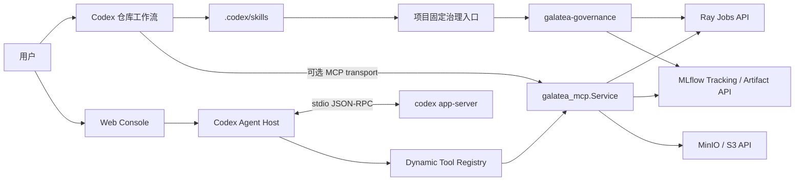

# Codex 与 Galatea 平台架构

更新：2026-10-14。Agent Runtime 统一为 Codex。仓库工作流由 Codex 和 `.codex/skills/`
驱动；Web Agent 使用 `agents/codex-app-server/` 托管原生 `codex app-server`。
平台继续通过 Ray、MLflow 和 S3 API 提供执行、治理和持久化。

## 当前组件和调用关系



| 组件 | 职责 | 源码与文档 |
| --- | --- | --- |
| Codex | 原生 Agent Loop、Thread/Turn、Skill、sandbox 和审批 | [Codex Host](../agents/codex-app-server/README.md) |
| Codex Agent Host | JSON-RPC 路由、持久化恢复、工具调用和带鉴权的 HTTP/SSE Console | [Host 架构](../agents/codex-app-server/docs/01-architecture.md) |
| Python 平台治理服务 | Campaign/Principal、预算、提交幂等、最终测试标记、Job 与 Artifact 证据 | [galatea-mcp](../services/galatea-mcp/README.md) |
| 项目治理库 | 项目 YAML、不可变 Release、Readiness、授权证据和固定 Ray 入口校验 | [galatea-governance](../packages/galatea-governance/README.md) |
| Skill | 仓库方法与可独立发布的训练流程 | [仓库 Skill](../.codex/skills/)、[Skill 包](../packages/galatea-training-skills/README.md) |
| Workload | 项目环境、数据/切分、固定 Driver、训练/评价和 Artifact | `train-model/<project>/` |

Host 的 17 个 Galatea 工具通过 Dynamic Tool Registry 直接调用 Python Service，
不启动第二个 MCP transport。独立 MCP transport 仍可供 Codex 客户端使用；两者不能
同时持有同一业务状态目录的 writer lock。Codex 负责模型推理和会话，平台库负责执行约束。

## 仓库入口迁移

已删除旧 Agent 插件目录、对应 npm/peer 依赖、工具注册、Session/审批适配、服务 unit、
专用运维文档和旧架构图。固定项目入口需要的领域校验及其六个测试套件迁至
`packages/galatea-governance/`；运行依赖只有 `yaml`，没有 Agent Runtime 或模型客户端。
`ray-cats-and-dogs/job/governed.mjs` 已改为导入该平台库。

猫狗项目继续使用已有 YAML/Release 契约和证据绑定。当前 Web Agent 使用独立的
Campaign/Registry 契约；接入项目时必须登记兼容的 workload、Release、身份和预算。
迁移平台库不等于已把所有 workload 注册到 Web Agent。

依赖安装与回归：

```bash
cd packages/galatea-governance
npm ci
npm test
npm run typecheck
npm run build
```

在仓库根目录使用具备平台依赖的 Python 环境：

```bash
python -m unittest discover -s tests -p 'test_*.py'
python -m unittest discover -s agents/codex-app-server/tests -p 'test_*.py'
PYTHONPATH=services/galatea-mcp/src \
  python -m unittest discover -s services/galatea-mcp/tests -p 'test_*.py'
```

## 执行与部署边界

每次 Training Run 仍须绑定不可变 Dataset/Split 和 Release、明确的目标集群与授权、
Readiness、固定 Driver、MLflow Run 和 Artifact 回读证据。迁移代码或授予执行权限
不能绕过这些检查，也不能通过通用 `ray job submit` 或本地训练替代治理入口。

生产 Alias 更新保持独立授权；Web Agent 首版工具集不提供推广工具。共享集群上的
项目 YAML 入口与 Campaign 服务各有自己的约束，不构成统一全局配额或租户隔离。
机器路径、服务端点和多集群操作见 [平台运行记忆](platform-runtime-memory.md)。

Web Agent 的生产模板仍要求经过接纳的 Runtime/合同/配置与独立模型凭据。当前机器
安装的 Codex CLI 版本不能直接替代 Host 已冻结的协议与发布证据；版本变化需重新验收。
源码入口统一完成后，生产服务是否上线以实际 unit、配置和健康检查为准。

部署使用 [配置与部署](../agents/codex-app-server/docs/06-config-deployment.md)、
[生产接纳记录](../agents/codex-app-server/docs/12-production-readiness.md)及
[unit 模板](../agents/codex-app-server/deploy/galatea-codex-agent.service)。
`doc/train-agent/` 中的 Python Runner 方案保留为历史参考，当前 Runtime/Host 文档优先。
