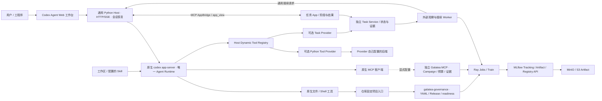

# Galatea 与 Codex Agent 架构

更新：2026-10-19。以当前工作区源码、配置与契约为准。

本文说明当前仓库可由代码和项目契约确认的架构。Codex 是唯一 Agent Runtime；仓库没有
DeepSeek Harness、`dsh-galatea` 插件或第二套 Agent Loop。Web Host 托管原生 Codex Runtime，
Ray/MLflow 治理由独立的平台组件和项目固定入口负责。可选的 Galatea 任务 App 已验证
普通 CSV 需求的真实会话自动展示与交付链路；完整业务端到端训练联动仍须单独验收。

## Agent Runtime 与 Web Host

- 原生 `codex app-server` 持有 Agent Loop、模型调用、Thread、Turn、Skill 执行、内建工具、
  沙箱策略和审批交互。Host 通过 stdio JSON-RPC 管理子进程并实现 Web 工作台与事件投影。
- `agents/codex-app-server/` 是通用 Host，不是 Agent Runtime 的替代实现，也不是 Galatea
  插件。它提供 HTTP/SSE Console、运行时进程管理、通用会话状态与恢复，以及可选的
  Dynamic Tool Registry。自定义 Python Provider 由管理员配置；没有配置时不暴露这些工具。
- Skill 根目录从 `agent.json` 配置并交给原生 Codex；MCP transport、服务和凭据从受控
  `codex-home/config.toml` 配置，由原生 Codex 连接。默认配置不包含业务 MCP；配置 stdio MCP 后，
  原生 Codex 启动其子进程，HTTP MCP 则由外部服务独立运行。
- Host 使用单一已配置身份，不是多租户授权系统。Console 面向受控网络；对外访问需由认证代理
  或等价网络边界保护。
- 当前 Host 配置版本是 `codex-agent/v2`，Runtime/API 协议锁定值见 Host 配置、兼容性证据
  和部署文档。旧业务 Host 的配置、状态与接纳记录不自动迁移。

## 聊天驱动的任务 App

用户在原聊天提出需求，Codex 调用 Task Provider 建立当前会话的任务。
成功回执中的通用 `app_view` 让 Host 自动展开 MCP App；App 通过 Host 与服务交互，
渲染阶段、进度、指标和可核验产物。补充目标和调整计划仍在原聊天进行。

`agents/galatea-app/` 独立保存业务状态，后台 Worker 观察外部任务并通过通用 Host 接口
请求原会话接续；它不调用模型，也不接管 Codex Agent Loop。Host 不定义训练阶段，
不 import 该业务服务；管理员显式配置 Provider、MCP、签名网关与服务身份后才启用。
组件间依赖工具、展示和快照契约，升级时需验证兼容性。

新聊天只绑定自己的任务。刷新恢复展示不等于重新执行；已受理外部任务由服务继续观察。
App 的训练确认不能签发治理授权、扩大预算或批准模型推广。
使用方式见 [App 产品介绍](../agents/galatea-app/docs/00-product-overview.md)，
实现和当前验证边界见 [App 验收记录](../agents/galatea-app/docs/10-implementation-acceptance.md)。

## 两个独立的 Galatea 治理入口

### 项目 YAML 固定入口

仓库中的 `.codex/skills/` 工作流使用项目声明和固定执行入口。项目的
`galatea.project.yaml`、不可变 Release、readiness、执行身份和证据由
[`packages/galatea-governance`](../packages/galatea-governance/README.md) 等项目代码检查，
实际入口由所属 `train-model/<project>/` 维护。治理库自身没有模型客户端、Agent Loop、
Session、MCP transport 或 Host 插件接口。

对于声明 `executionBackend: ray` 的项目，所有 Training Run（包括 smoke、baseline、Trial、
Champion 和重训）都必须通过项目固定的 Ray 治理入口；本地开发、短时运行、私有或
`non-promotable` 标签不构成绕过理由。主机、集群、数据、预算、最终测试与晋级按项目契约
分别验证。Job 成功本身不是质量通过或生产推广授权。

### 独立 Galatea MCP Campaign 服务

[`services/galatea-mcp`](../services/galatea-mcp/README.md) 独立实现项目与 Campaign 注册、受限
工具、服务端授权、预算、幂等提交/恢复以及 Run、Artifact 和评价证据检查。它可经 MCP
stdio 或 Streamable HTTP transport 服务原生 Codex 客户端；transport 和业务服务与 Host
分开部署。

Host 当前没有 Galatea Adapter，不直接 import `galatea_mcp.Service`，也不默认加载其工具目录。
需要从 Web 工作台使用 Campaign MCP 时，必须由管理员在该 Host 的 Codex MCP 配置中显式连接，
并对外部身份、工具可见性、审批、幂等、等待/恢复和训练结果完成单独验收。配置一个 MCP
连接不会把 Campaign 服务转成项目 YAML 治理入口，反向也一样。两者状态、Plan、预算、Release
和数据/测试约束不可互换。

## 权限、训练状态与恢复

Codex 的沙箱、工具许可和原生审批决定 Agent 是否能执行相应本地操作或完成需要审查的调用。
这些设置不签发 Campaign 授权、不批准数据使用或 GPU 预算，也不授予最终测试和生产 Alias
权限。项目入口或 Campaign MCP 必须在服务端/执行端验证各自的业务契约，不能只靠 Skill 或提示词。

Codex 管理 Thread/Turn 生命周期；Host 按自身实现恢复原生会话并保护通用写调用的操作身份。
Ray Job、Campaign、MLflow Run 与业务回执由各自项目入口或 MCP 服务持有。通用 Host 不持续
轮询训练 Job、不解释训练阶段、不把 `wait_external` 自动变成调度事件，也不负责恢复 Campaign。

[`packages/galatea-training-skills`](../packages/galatea-training-skills/README.md) 发布的独立
Skill 包保留历史 v1 `Agent Turn` 输出和 `wait_external` 工作流约定；先前消费该契约的 Python
Runner 已删除。该包不是当前通用 Host 的 Campaign 调度插件。需要使用该流程时，需实现并验收
能消费该历史结构化输出、等待外部 Job、按原 Thread 恢复决策的独立编排组件。
新任务 App 使用自己的任务、证据与接续契约，不是该历史 Runner 的兼容替代；
仓库训练工作流仍以 `.codex/skills/` 和项目固定入口为准。

## 状态与验收边界

- Host 的浏览器工作台、动态扩展、原生协议和恢复路径有独立测试；测试替身不证明外部业务
  MCP 的真实认证、项目权限或真实训练成功。
- 项目治理入口、Galatea MCP、Codex Host 和模型 workload 分别发布和配置；更新源码、配置、
  Skill、依赖、入口或数据身份后按所属契约重新构建不可变 Release/运行时接纳记录。
- 仓库文档和模拟后端测试不等于某台主机部署完成、某个 Campaign 被批准、GPU 训练验收、
  最终 holdout 评测或模型晋级已授权。

## 当前实现文档

源码核对入口：[Host 装配](../agents/codex-app-server/src/codex_agent/app.py)、
[配置解析](../agents/codex-app-server/src/codex_agent/config.py)、
[Provider 扩展](../agents/codex-app-server/src/codex_agent/providers.py)、
[MCP transport](../services/galatea-mcp/src/galatea_mcp/server.py) 和
[项目治理控制器](../packages/galatea-governance/src/tools/controller.ts)。

- [Codex Agent Host](../agents/codex-app-server/README.md)
- [Galatea 任务 App 产品介绍](../agents/galatea-app/docs/00-product-overview.md)
- [Galatea 任务 App 技术方案](../agents/galatea-app/docs/README.md)
- [Host 架构与集成边界](../agents/codex-app-server/docs/01-architecture.md)
- [Host 配置与部署](../agents/codex-app-server/docs/06-config-deployment.md)
- [Host 权限和扩展信任](../agents/codex-app-server/docs/07-security-boundaries.md)
- [Galatea MCP](../services/galatea-mcp/README.md)
- [项目治理库](../packages/galatea-governance/README.md)
- [当前机器平台运行记忆](platform-runtime-memory.md)
- [`doc/train-agent/`](train-agent/README.md) 提供当前文档导航并留存已归档 Runner/Console
  方案；历史设计、命令和验收数字不是当前实现或部署依据。
