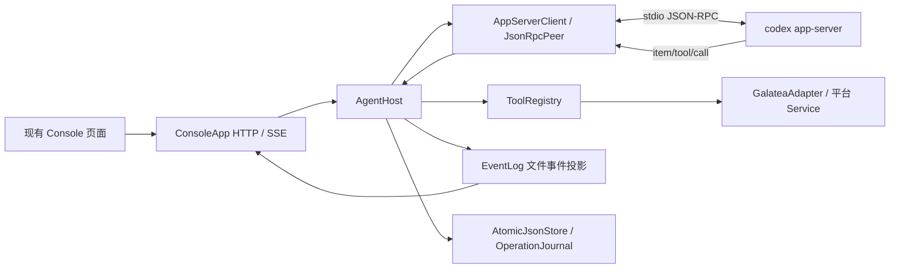

# 01 重构前基线与当期边界（历史记录）

> **历史 Console 设计（2026-10-16 标注）**：下文“当前/本期/首版”指重构前版本，
> 不作为现行功能或部署依据。当前为通用 Host，无内置 Galatea Adapter；
> Skill/MCP、前端构建和 SQLite 观察存储以现行组件文档为准。
> 当前边界见 [总体架构](../../agent-galatea.md)、[Host 文档](https://github.com/lunasaw/open-codex/blob/b5d9a0d26b14a8d8c0c308b6229bba866ac4d70a/docs/README.md)。

2026-10-16 更新：下文保留 2026-10-15 Console 改造前的源码基线，不再描述当前实现。通用 Host 重构已移除进程内 GalateaAdapter、业务包依赖和固定工具目录，Skill、Tool Provider 与外部 MCP 改为独立配置。当前架构、启动方式及验证边界以 [Codex Agent Host](https://github.com/lunasaw/open-codex/blob/b5d9a0d26b14a8d8c0c308b6229bba866ac4d70a/README.md) 为准。

历史核对日期：2026-10-15。本文正文记录当时 checkout 的事实；下文“当前”均指该历史版本。
方案中的目标行为与当前代码能力必须分开描述，不能把旧设计文档中的计划视为已实现。

本期交付只把现有 Host 包装成训练 Agent 的网页聊天与追踪台：浏览器负责文字对话和观察
训练工具调用过程，模型、Agent Loop、工具合同、训练/评估后端和 Skill 配置保持现状。
下文的“目标”均是待实施的 Console 展示改造，不表示当前 checkout 已经具备这些能力。

## 1. Galatea 当前接入链路

关键装配入口为 [app.py](https://github.com/lunasaw/open-codex/blob/b5d9a0d26b14a8d8c0c308b6229bba866ac4d70a/src/codex_agent/app.py)。
Console 与 Host 在同一应用内，使用既有 Host 执行会话动作；浏览器没有直接连接原生 Runtime。

| 模块 | 当前行为 | 与本次需求的关系 |
| --- | --- | --- |
| [rpc.py](https://github.com/lunasaw/open-codex/blob/b5d9a0d26b14a8d8c0c308b6229bba866ac4d70a/src/codex_agent/rpc.py) | 单 reader 消费 JSON-RPC，区分 response、server request、notification；server request 独立分发 | 没有覆盖双向收发的统一 observer |
| [process.py](https://github.com/lunasaw/open-codex/blob/b5d9a0d26b14a8d8c0c308b6229bba866ac4d70a/src/codex_agent/process.py) | 启动并托管 app-server，初始化 client；保存运行进程记录 | observer 必须在 initialize 前接入，才能覆盖启动事件 |
| [host.py](https://github.com/lunasaw/open-codex/blob/b5d9a0d26b14a8d8c0c308b6229bba866ac4d70a/src/codex_agent/host.py) | 会话/轮次管理、工具路由、中断、恢复和生命周期投影 | 是现有控制入口；其业务处理范围不能充当完整事件采集范围 |
| [events.py](https://github.com/lunasaw/open-codex/blob/b5d9a0d26b14a8d8c0c308b6229bba866ac4d70a/src/codex_agent/events.py) | 按 session 写 JSONL，分配 seq，回放并生成 loop | 当前是文件存储，公开字段严格裁剪，没有存储端口与内存实现 |
| [state.py](https://github.com/lunasaw/open-codex/blob/b5d9a0d26b14a8d8c0c308b6229bba866ac4d70a/src/codex_agent/state.py) | 原子 JSON 文件、工具意图/回执、单写进程锁 | 承担执行和恢复正确性，不能未经确认归入展示缓存 |
| [console/server.py](https://github.com/lunasaw/open-codex/blob/b5d9a0d26b14a8d8c0c308b6229bba866ac4d70a/src/codex_agent/console/server.py) | ASGI HTTP/SSE、Bearer/Origin 校验、HTTP 幂等记录 | 可以扩展既有服务；当前写请求记录依赖 Host 文件 store |
| [console/static/app.js](https://github.com/lunasaw/open-codex/blob/b5d9a0d26b14a8d8c0c308b6229bba866ac4d70a/src/codex_agent/console/static/app.js) | 会话列表、消息发送、中断/关闭/恢复、步骤筛选、fetch SSE 重连 | 当前显示步骤状态，没有完整对话内容和原生事件检查视图 |

当前带 Token 的 loopback Console 可以验证 Host 的基础会话控制链路，但不能作为本期“网页聊天与
追踪台”已经完成的证据。完整 assistant 文本、全量双向协议观察、训练工具的可读调用轨迹和
断线续读都属于待实施目标。

### 事件覆盖缺口

`AgentHost.handle_notification()` 当前处理并投影的通知为：

- `turn/started`、`turn/completed`；
- `item/started`、`item/completed`；
- `item/agentMessage/delta`；
- `thread/tokenUsage/updated`。

其他通知会提前返回。即使收到 assistant delta，投影也只保存 method、status、item type 等元数据，
不保存 delta 文本。因此当前页面中的“回复步骤”不等于可阅读的流式回复。

此外，当前实现没有统一保留 Host 发出的 request/notification、收到的 response/error、
Runtime 发起的所有 server request，以及 Host 对它们的 response/error。
没有已绑定 session 的启动级事件也不会进入现有 session 事件链路。

`handle_tool_call()` 当前只接收 `item/tool/call`；其他 server request 返回 `-32601`。
`start_thread()` 默认 `approvalPolicy=never`、`sandbox=read-only`。
不能将“把请求展示出来”直接等同于“已经支持在 Console 完成审批或用户输入回复”。

### 工具、Skill 与训练/推理边界

当前 Host 通过进程内 `ToolRegistry` 暴露版本化 Galatea 工具，并按既有 principal、项目和
Campaign 合同校验调用；本期复用这套目录，不新增、放宽或重命名工具。训练、评估和作业状态
仍由现有 Galatea、Ray、MLflow、对象存储等平台组件负责，Console 只提交现有 Host 支持的
消息并展示调用、回执和状态，不增加通用推理 API 或训练算法。

当前 `galatea-codex-app-server` 的发行依赖仍包含 `galatea-mcp==0.1.0`；`GalateaAdapter`
通过 transport-neutral 的 `Service`/envelope 调用业务，而不是启动 MCP transport。这个既有
业务包依赖不能表述成“只安装 codex-app-server 即可完成训练”，但也不等于 Console 复制了
`service-manager-agent` 的代码。

当前示例 Runtime 配置关闭 Skills，源码中也没有本期 Console 注入 Skill 的接线。方案不应把
Skill 文件存在于仓库解释为已启用能力；若未来接入 Skill，应作为单独的版本化变更，记录包版本、
内容摘要和 Runtime 验收证据。

### 当前存储与恢复耦合

| 数据 | 当前保存位置/方式 | 用途 |
| --- | --- | --- |
| Session、session 创建意图 | `state_dir/sessions`、`session-intents` JSON | thread 关联、会话状态与启动结果核对 |
| 用户消息受理记录 | `state_dir/requests` JSON | request 去重、turn 关联与结果核对 |
| HTTP 写操作记录 | `state_dir/http-requests` JSON | API 重复提交检测与回执复用 |
| 工具调用意图和回执 | `state_dir/tool-calls` JSON | 避免对结果未知的副作用工具盲目重执行 |
| Runtime 进程记录 | `state_dir/runtime-process.json` | 旧进程组检查及启动/停止状态 |
| Host 单写锁 | `state_dir/.host.lock` | 防止多个 Host 同时拥有同一状态目录 |
| 公开事件投影 | `event_dir/<session_id>.jsonl` | SSE 回放和 Agent Loop 视图 |
| Codex 会话 | 配置指定的 `CODEX_HOME`，由 Runtime 自己管理 | 原生 thread 恢复 |

Host 列举 session 和 OperationJournal 列举记录时直接遍历文件目录；Host 启动还直接使用
`store.root` 加文件锁。Q1 已确认保留这些 Host 持久化，因此不修改其枚举、文件锁和恢复合同。
EventLog 的文件回放只用于 Console，Host 恢复查询的是 session/request、OperationJournal 与
Runtime/平台事实；该观察日志本次迁移到内存，不能与工具执行记录混为一谈。

当前 EventLog 写入属于同步调用，持久化失败会影响 Host 调用；浏览器 SSE 断开只结束订阅。
目标方案将观察通道与执行权威记录分开，具体错误语义见 [架构方案](02-architecture.md)。

## 2. service-manager-agent 可借鉴的实现

参考仓库是同级目录；以下链接均指向此次实际读取的源码。

| 参考入口 | 已存在的实现 | 可复用的设计思路 |
| --- | --- | --- |
| [native/rpc_client.py](../../../../service-manager-agent/src/service_manager/infrastructure/native/rpc_client.py) | RPC observer，包含方向与调用上下文；observer 异常独立处理 | 在业务分发之前镜像入站消息，并在出站发送路径镜像消息 |
| [console/native_trace.py](../../../../service-manager-agent/src/console/native_trace.py) | 区分 request/response/notification，关联 task/thread/request/turn/item；异步批量写入 | 关联与展示逻辑独立于业务处理；观察队列不阻塞原生 reader |
| [console/store.py](../../../../service-manager-agent/src/console/store.py) | Redis 会话和事件，TTL、trace 索引、游标、历史查询和 gap 判断 | 抽取事件日志所需的语义接口；不直接复制 Redis 调用到 Galatea |
| [console/server.py](../../../../service-manager-agent/src/console/server.py) | `native-history` 分页查询和 `native-events` SSE；发布 trace 状态 | 同时支持历史加载与实时增量，连接断开后按游标续读 |
| [console/static/agent-loop.js](../../../../service-manager-agent/src/console/static/agent-loop.js) | 按 turn/item/call 聚合回复、摘要、工具、计划和错误 | 把原生事件投影为可读步骤，保留原始事件检查入口 |
| [console/static/app.js](../../../../service-manager-agent/src/console/static/app.js) | 原生事件与流程视图、方向/类别筛选、参数和结果展开 | 借鉴交互组织，移除服务管家专有 task/shop/人工交接语义 |

参考实现不是无条件完整留存：

- `NativeTrace` 使用有界队列，队列满或存储失败时累计 dropped/error；不能把它表述为零丢失保证。
- 字段投影会脱敏、截断；私有推理正文被省略，公开摘要可展示。
- 维护流量有专门的过滤逻辑。
- Redis 事件有一天保留期；历史事件可能过期。
- Agent Loop 聚合器只识别一组方法和 item 类型，不等于全部原生事件类型。

参考仓库只提供设计依据，不作为运行时依赖或代码来源。实现后应使用干净环境构建/安装
`galatea/agents/codex-app-server`，确认不需要导入或复制 `service-manager-agent` 的业务模块；
本文件的源码核对本身不等于独立性验证。

本次“所有事件”需求需要明确覆盖面和完整性状态，不能直接照搬参考项目的过滤表或把裁剪静默隐藏。

## 3. 已证实的接入方向

以下是源码证据支持的接入点；已确认的范围见 [需求决定](README.md#已确认的需求决定)：

1. 使用现有 `JsonRpcPeer` 的收发边界观察双向消息；通知业务处理器继续负责状态机。
2. 独立处理协议关联和事件投影，避免要求每个业务 handler 手工补事件。
3. 保留没有 session 的运行实例级事件；有明确关联依据后再绑定 session/thread，不能关联到“最近会话”。
4. 已识别方法提供结构化展示；未识别方法仍需要通用事件展示，避免升级后静默丢失类型。
5. Console 通过存储端口读取事件与快照；内存及后续 Redis 实现遵守同一回放、游标和错误契约，首版不淘汰历史。
6. API 查询和前端 SSE 不能直接依赖 Python 字典、Redis key、Stream ID 或文件路径。
7. 事件回放仅用于观察，不能触发模型调用、工具重执行或重复回复 server request。

## 4. 证据边界

- 当前仓库包含 Codex `0.153.4` 的 [fixture manifest](https://github.com/lunasaw/open-codex/blob/b5d9a0d26b14a8d8c0c308b6229bba866ac4d70a/tests/fixtures/codex-0.153.4/manifest.json)
  和部分 schema；这是版本化测试依据，不是此次已核实的在线服务版本。
- manifest 自身标注 `unverified-development-fixture`，不能单凭它证明生产接纳。
- [既有协议文档](https://github.com/lunasaw/open-codex/blob/b5d9a0d26b14a8d8c0c308b6229bba866ac4d70a/docs/02-app-server-protocol.md) 引用的外部 Codex
  源码目录此次不可用；现有 fixture 也不是完整 server request/notification 清单。
- 官方文档检索工具本次返回不可用，官方 App Server 页面直接访问返回 HTTP 403；没有把未读取的
  官方页面作为已验证依据。详细能力或新方法名须在实现阶段对目标 Runtime schema 补充核验。
- 本次只读取源码和文档，没有核验正在运行的服务、启动 Runtime、调用真实模型或执行训练。
- 当前目标是技术方案；尚未执行代码改造或声称网页聊天、全量追踪、Skill 接入或训练结果已通过测试。

技术方案从 [02 架构与职责](02-architecture.md) 开始；本文的现状记录不表示这些目标改造已经完成。
