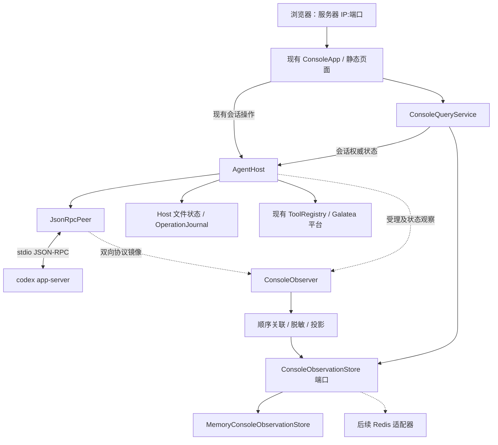

# 02 架构与职责

本期定位是“训练 Agent 的网页聊天与追踪台”。改造范围限于现有 Galatea Python Host 内的
HTTP/SSE、浏览器页面、协议观察和内存投影；不改造 Codex 模型或 Agent Loop，不接入 Skill，
不新增训练/推理后端。页面调用仍由既有 Host、Runtime 和 Galatea 工具链完成。

## 1. 部署与组件关系

扩展 `agents/codex-app-server` 现有 Python ASGI 服务及静态页面，沿用 `codex-agent serve`
启动入口。首版为单进程、单 Host；前端 HTML/CSS/JavaScript 与 API 同源。
不新增独立服务、Node 构建链、第二个 Agent Loop 或任务管理器。

内网监听使用可配置 `host/port`。实施配置建议为 `0.0.0.0:18880`，沿用既有端口；该值是
方案默认，不表示端口已检查或服务已启动。浏览器使用实际服务器 IP，不能把 `0.0.0.0` 当访问地址。
首版没有登录页、Token 输入或 Console 鉴权；同源静态资源和接口共用这个端口。
这代表应用本身不检查访问者身份。非回环监听只能部署在防火墙或网络 ACL 已限制为可信内网
来源的环境，不得直接暴露到公网；没有网络边界时应保留鉴权，不应按此无鉴权方案开放。

## 2. 依赖边界与代码独立性

本期不增加独立服务、Node、Redis、隧道、外部追踪平台或新的 Agent Loop。Console 页面和观察
实现属于现有 `agents/codex-app-server` Python 包，但整个训练 Agent 不能脱离底层 Codex
app-server、模型服务及 Galatea 平台依赖单独运行。

| 依赖 | 本期用途 | 是否新增 |
| --- | --- | --- |
| Codex app-server 与配置的模型服务 | 模型对话、thread/turn 协议和 Runtime 生命周期 | 否，继续依赖现有版本与凭据 |
| Galatea Python Host / ToolRegistry | 会话入口、权限检查、训练工具合同和工具路由 | 否，直接复用现有实现 |
| Ray、MLflow、对象存储及项目配置 | 现有训练/评估作业、指标和产物读写 | 否，由被调用的 Galatea 工具按需使用 |
| Python ASGI 服务与系统运行环境 | 提供同源网页、HTTP API、SSE 和进程管理 | 否，复用当前部署栈 |
| MCP Python SDK（当前发行包依赖图） | 当前 `galatea-mcp` 包的传递依赖 | 不新增；本期 Host 不启动 MCP transport |
| service-manager-agent | 对照交互和旁路观察设计 | 不作为依赖；不导入、不复制其业务模块 |

因此这里的“代码独立”仅指 Console 功能在 Galatea 当前 Agent 包内实现，不依赖参考项目的
运行时代码；不表示训练 Agent 能脱离 Codex Runtime、模型或训练平台组件运行。是否可干净构建、
安装并启动，应在实现后通过隔离环境验收，当前方案文档不能替代该证据。

## 3. 状态归属

| 状态 | 权威所有者 | 首版介质 | 重启后的行为 |
| --- | --- | --- | --- |
| 会话、thread 绑定、活动 turn、配置绑定 | AgentHost | 现有 AtomicJsonStore | 继续按已有核对/恢复流程处理 |
| session 创建意图、消息/HTTP 幂等记录 | AgentHost / HTTP 写入流程 | 现有 AtomicJsonStore | 复用已有回执；结果未知时先核对 |
| 工具调用意图、业务结果、OperationJournal | 现有 Registry/Host | 现有文件状态 | 保留既有避免重复副作用的语义 |
| Runtime 进程组记录、单写锁 | ManagedProcess / AgentHost | 现有文件与锁 | 保留旧进程检查及单写约束 |
| Codex 原生会话 | Codex Runtime | 原有 CODEX_HOME | 通过原生协议恢复，不直接解析内部文件 |
| 全量可展示事件、消息文本、Loop 投影、关联索引 | Console 观察层 | 新增内存适配器 | Host 服务进程重启时清空 |
| SSE 连接、等待器、浏览器游标/界面状态 | 当前 HTTP 进程/浏览器 | 内存 | 断开后重连；不能持久化连接对象 |
| Galatea、Ray、MLflow、MinIO 业务数据 | 原有平台组件 | 各自原有存储 | 本次 Console 方案不改变其行为 |

现有 `events.py/EventLog` 的 JSONL 属于观察投影。本次由内存观察链路接替，停止创建/追加
Console JSONL，移除 `event_dir` 配置依赖。旧文件不自动删除，也不作为新 Console 的历史来源。
既有 `state_dir` 及其中的操作记录全部保留。不能因“Console 不用 Redis”去修改 Ray 等服务的存储。

## 4. 模块职责

| 拟定模块 | 职责 | 不应承担的职责 |
| --- | --- | --- |
| `console/observer.py` | 同步接收观察副本、分配接收序号、放入进程内队列 | 等待 Redis、调用模型、裁决权限 |
| `console/correlation.py` | 根据显式上下文、协议 ID 和 thread 绑定关联消息 | 根据最近一次会话或自然语言猜归属 |
| `console/projection.py` | 脱敏后的事件生成对话/Loop 展示数据 | 改变 Host 状态、重新执行工具 |
| `console/models.py` | 事件、游标、快照、完整性和状态结构 | 暴露 Redis/文件实现细节 |
| `console/ports.py` | 观察存储端口、结果和异常合同 | 提供 Redis 命令透传接口 |
| `console/adapters/memory.py` | 内存事件日志、索引、快照、顺序提交与通知 | 持久化 Host 业务状态 |
| `console/service.py` | 生命周期、顺序写入 worker、历史查询、快照与状态 | 取代 AgentHost 受理与恢复逻辑 |
| `console/server.py` | HTTP/SSE、错误映射与现有 Host 操作入口 | 直接访问适配器内部字典或 Redis key |

模块按职责划分，具体是否合并小文件可在实施中调整；依赖方向固定为业务/查询依赖端口，
装配层选择适配器。既有 `AppServerClient` 已承担 Runtime 协议包装，不再抽象一个假想的多 Runtime 框架。

## 5. 接线与生命周期

1. `build_host()` 先创建 memory store、Console 服务和 observer，再创建 ManagedProcess/Host。
2. ASGI startup 先启动观察 worker，再调用 Host.start()；observer 在 Runtime 的 initialize 之前安装。
3. Host 的恢复记录提供已知 session/thread 绑定。新会话创建前已有 session_id，将其作为
   本地 context 传给 thread/start 的观察入口；context 不写入原生 JSON-RPC 参数。
4. JSON-RPC reader/writer 向 observer 提交副本；单个观察 worker 按序完成关联、脱敏、投影和存储。
5. Host 原先 `events.append()` 的受理、生命周期、工具诊断改为观察事件提交。Host 的
   `store.write()` 和 OperationJournal 写前/写后顺序保留。
6. Console 的历史、快照和 SSE 统一经过查询服务；会话列表、控制结果仍由 Host 提供。
7. shutdown 停止新 HTTP 写入，按现有逻辑停止 Host 和 Runtime，再排空已经捕获的观察队列，
   最后关闭观察服务。进程最终退出后内存释放；这一过程不向磁盘补存事件。

浏览器连接不是采集开关：没有页面连接时仍采集所有消息；一个连接断开也不会结束采集。
同一 Host 进程内 Runtime 重新启动时分配新的 `runtime_instance_id`，Console 历史继续保留；
Host 服务进程重启时才更换观察 `epoch` 并清空历史。

## 6. 控制路径与观察路径

现有会话操作、平台权限、工具校验、Runtime 发布校验继续有效。
Q2 没有授权新增 server request 回复能力：审批、权限申请、补充信息请求及 Host 实际拒绝回执
均展示，但不生成可点击的同意/拒绝/回答控件，也不改 `approvalPolicy`。

移除 Console 的 Token 认证不删除 Host principal、工具 actions、项目/Campaign 范围和恢复核验。
这意味着所有能够访问此 Console 的客户端都可使用同一 Host 已开放的控制接口；不设计用户账户、
租户权限或访客角色。非回环监听必须由部署网络 ACL/防火墙限制来源；Host principal 是共享执行
身份，不是访问者身份校验，也不应被描述成 Console 的安全边界。

观察写入不在 JSON-RPC reader 内等待网络或浏览器。内存模式不设置丢弃式队列上限，不能照搬
参考项目 `QueueFull → dropped++` 后继续宣称历史完整。若出现观察器异常，必须把
`observation_status=incomplete/unavailable` 和错误显式提供给状态接口与页面；执行结果仍以 Host 为准。
不能用观察失败触发重复执行，也不能把已运行的 turn 伪装成失败或完成。

内存耗尽或进程崩溃无法保证继续观察；无持久化的历史随进程丢失。这是 Q5 保留策略的物理边界，
不是引入自动淘汰、截断、采样或落盘的理由。运行状态应展示事件数、累计编码字节数和待写数量，
其中编码字节数不等于实际 Python RSS。首期适用于有明确网络边界、受控使用时段和资源监测的
内部部署；推广前需用真实流量测量增长速率并确定运维侧的监控/重启窗口，不能承诺无限期运行。

## 7. 本期不交付的能力

- 新模型、模型质量优化、独立模型推理 API 或通用推理工作台。
- 新训练算法、训练任务编排器，或改写现有 Galatea/Ray/MLflow 作业合同。
- Skill 安装、启用、编辑、分发或 Skill 效果验收；当前配置保持不变。
- 新增或放宽 Galatea 工具及其权限，不提供审批/权限/提问请求的页面回复入口。
- “比原生 Codex 更好”的泛化结论。可验证的收益限于现有 Galatea 训练工具使用体验和可追踪性；
  若需比较模型或 Agent 效果，另行设计同模型、同任务和同权限的基准评测。
